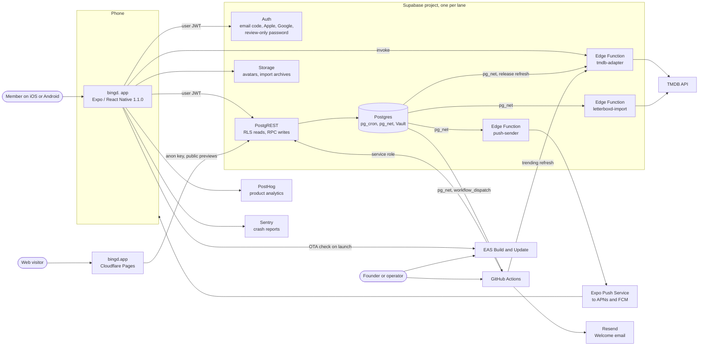
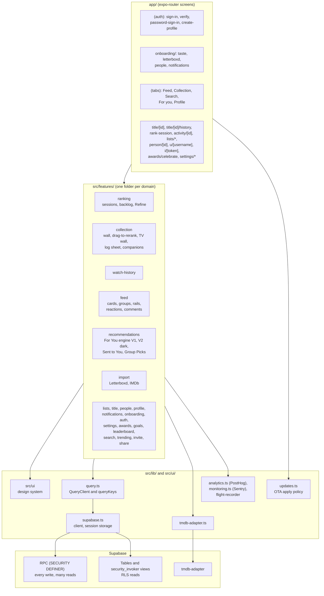
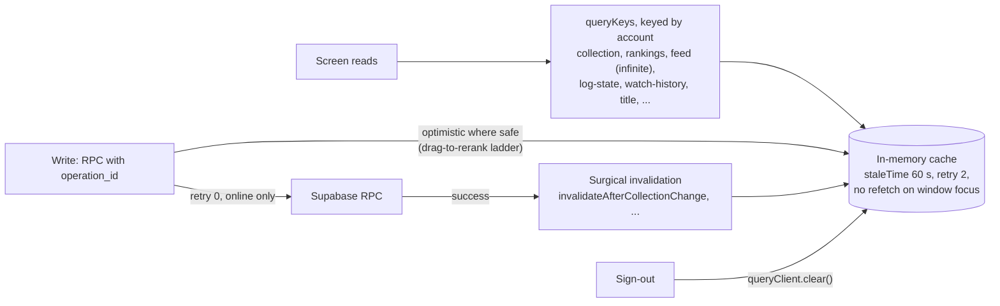
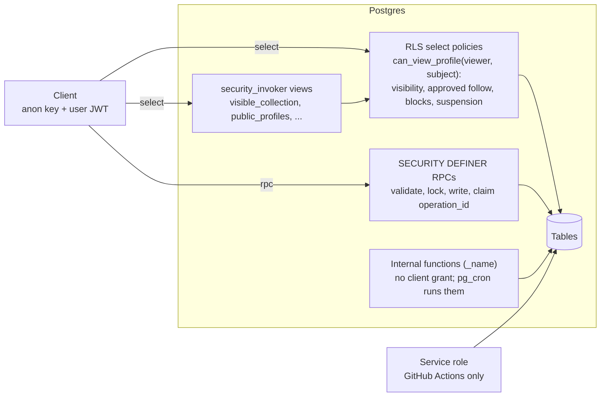
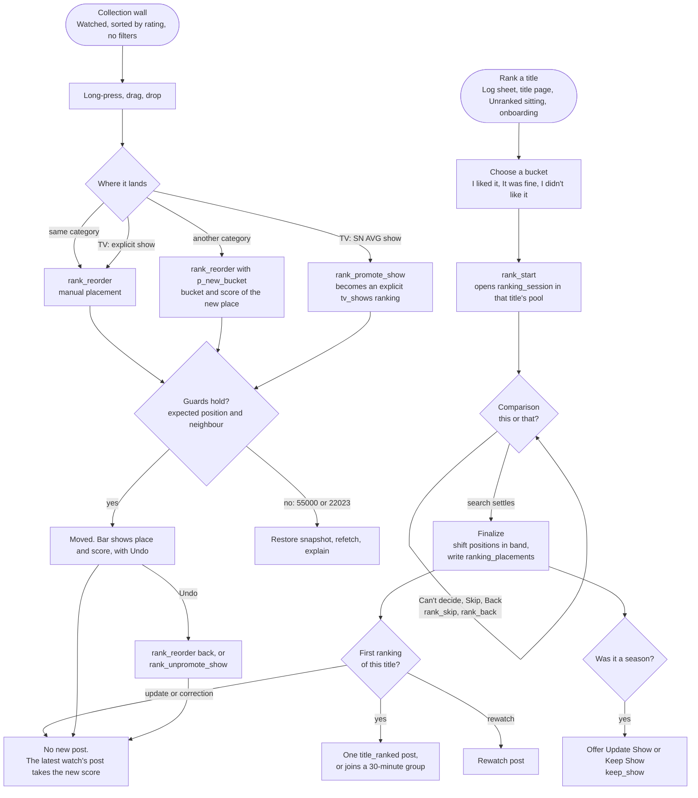
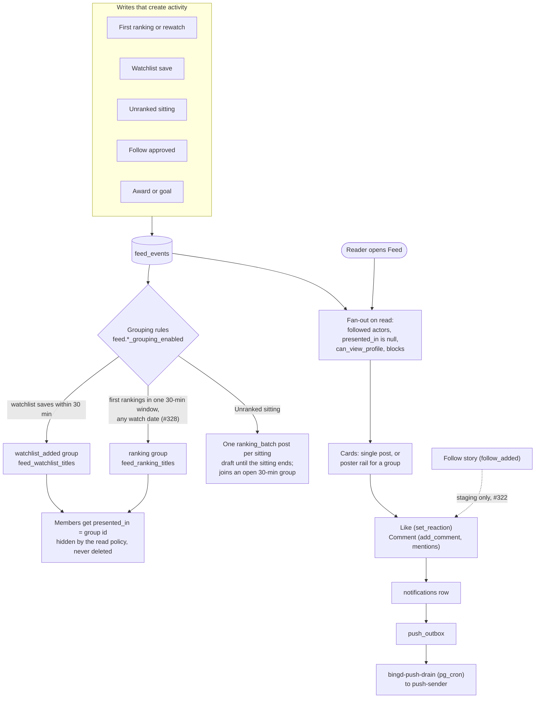
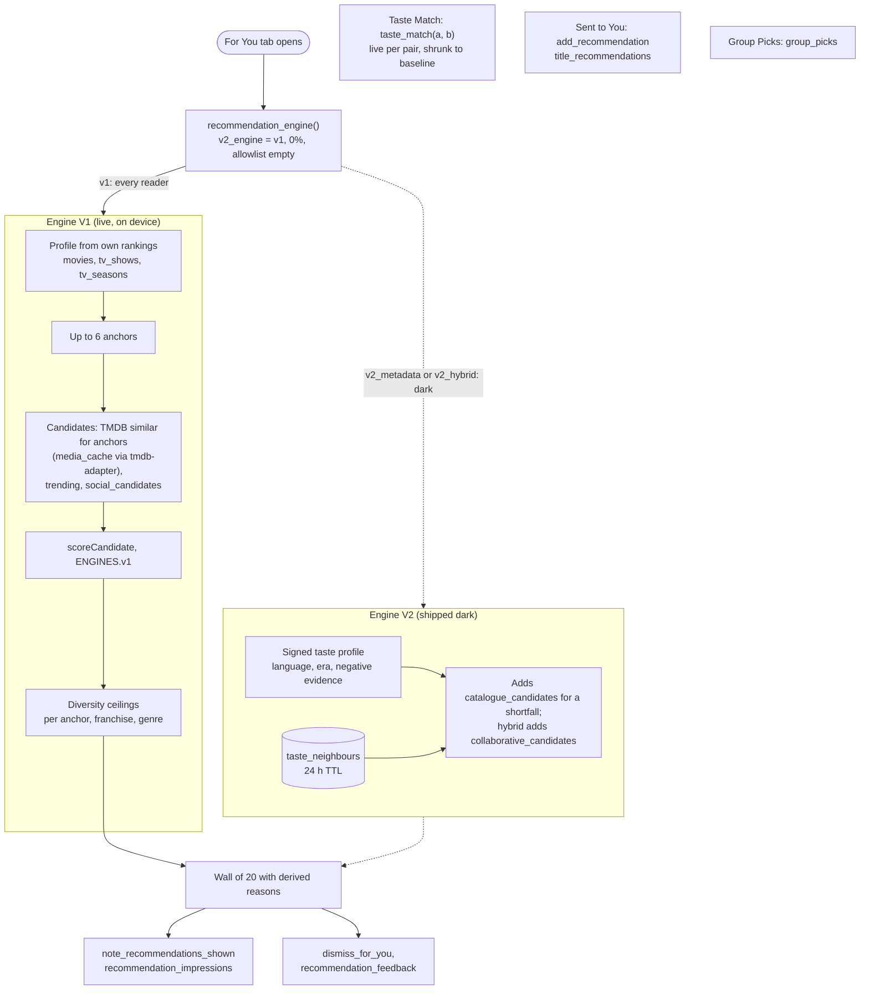
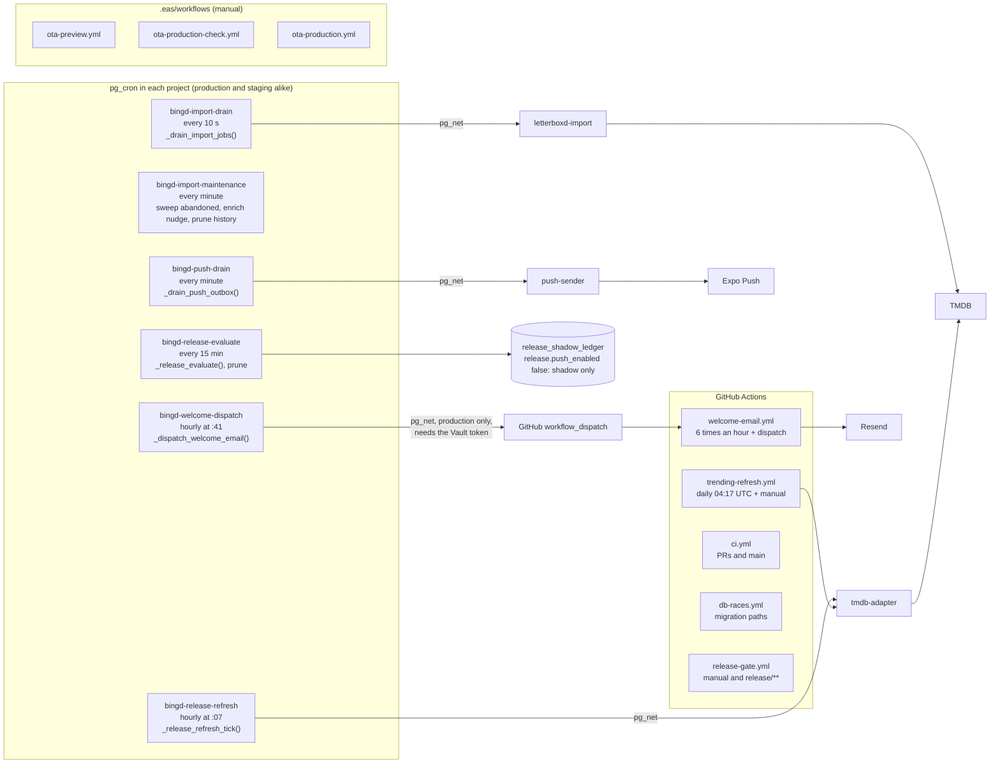
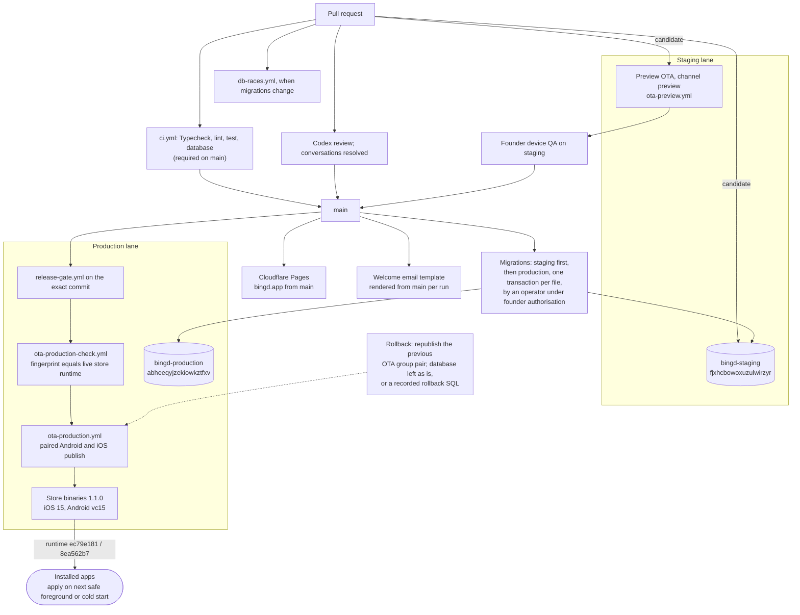

# Architecture diagrams

**As of 2026-11-20.** Production client `1c24b5cd` (OTA), production database at 208
migrations (head `20261130000300`), `main` `ecd03517`. Source-controlled Mermaid; GitHub
renders each block.

**Rule for these diagrams: only components that exist are drawn.** Each one was checked
against the code on `main`, the workflow files, and a read-only `cron.job` query on
production and staging (2026-11-20). Something shipped dark is drawn dashed and labelled
*dark*. Something on staging only is labelled *staging only*. A design that was never built,
such as `recs-builder`, `import-worker`, `notify-dispatch`, the SQLite mirror and the outbox,
is not drawn. [`README.md`](./README.md) § System shape records where the v1 design differs.

What is live: [`../release/production-state.md`](../release/production-state.md).
Background job operations: see `docs/ops/background-jobs.md` (being added by the reliability
workstream) and `docs/ops/reliability-2026-11-20.md`.

| # | Diagram | Detail lives in |
|---|---|---|
| 1 | [System context](#1-system-context) | [`README.md`](./README.md), [`web-deployment.md`](./web-deployment.md) |
| 2 | [App architecture](#2-app-architecture) | [`client.md`](./client.md), [`api.md`](./api.md) |
| 3 | [Database](#3-database) | [`data-model.md`](./data-model.md) |
| 4 | [Ranking flow](#4-ranking-flow) | [`ranking.md`](./ranking.md), [`collection-rerank.md`](./collection-rerank.md) |
| 5 | [Feed and social](#5-feed-and-social) | [`../feed/expanded-grouping.md`](../feed/expanded-grouping.md), [`push.md`](./push.md) |
| 6 | [Recommendations](#6-recommendations) | [`recommendations.md`](./recommendations.md), [`recommendations-v2.md`](./recommendations-v2.md) |
| 7 | [Background jobs](#7-background-jobs) | [`push.md`](./push.md), [`../release/push-operations.md`](../release/push-operations.md), [`../release/trending-operations.md`](../release/trending-operations.md) |
| 8 | [Release architecture](#8-release-architecture) | [`../release/release-lanes.md`](../release/release-lanes.md), [`../release/safe-update-runbook.md`](../release/safe-update-runbook.md), [`../release/cloud-ota.md`](../release/cloud-ota.md) |

---

## 1. System context

- The client holds the anon key and the user's JWT only. TMDB's key lives in `tmdb-adapter` and
  `letterboxd-import`. The service-role key lives only in GitHub Actions Environment secrets
  (H-1, closed by #317).
- The *workflow_dispatch* edge is `bingd-welcome-dispatch` (#331). It is live but inert: it
  returns `unconfigured` until the founder stores the production Vault token. Until then the
  Welcome workflow's own GitHub schedule starts the sends.
- Production and staging are two Supabase projects with the same migrations
  (diagram 8). The app's Preview lane points at staging only.

## 2. App architecture

**TanStack Query cache strategy** (`src/lib/query.ts`, [`client.md`](./client.md) §3):

- No persisted cache, no SQLite mirror and no outbox. Every write is online, and a write RPC
  claims an `operation_id`, so a retried write applies once.
- Keys carry the account id. That keeps one account's notes, watch dates and scores out of
  another account's reads on the same device.

## 3. Database

Core entities only. All 82 tables in `public` have row-level security enabled (read
2026-11-20). Clients get `select` under policy and write only through RPCs.

```mermaid
erDiagram
  profiles ||--o{ follows : "follower or followee"
  profiles ||--o{ blocks : "blocker or blocked"
  profiles ||--o{ user_media : owns
  profiles ||--o{ rankings : owns
  profiles ||--o{ watch_events : owns
  profiles ||--o{ watchlist : owns
  profiles ||--o{ lists : owns
  profiles ||--o{ feed_events : "actor"
  profiles ||--o{ notifications : "recipient"
  profiles ||--o{ device_tokens : has
  media_items ||--o{ media_items : "series to season (parent_id)"
  media_items ||--o{ user_media : ""
  media_items ||--o{ rankings : ""
  media_items ||--o{ watch_events : ""
  rankings ||--o{ ranking_placements : "explained by"
  ranking_sessions ||--o{ comparisons : ""
  ranking_placements ||--o| show_promotions : "TV wall promotion"
  watch_events ||--o{ watch_event_companions : "watched with"
  lists ||--o{ list_items : ""
  feed_events ||--o{ feed_events : "presented_in (group)"
  feed_events ||--o{ feed_ranking_titles : "group members"
  feed_events ||--o{ feed_watchlist_titles : "session members"
  feed_events ||--o{ reactions : ""
  feed_events ||--o{ comments : ""
  notifications ||--o| push_outbox : "push copy"
  import_jobs ||--o{ import_rows : ""

  profiles {
    uuid id PK
    text username
    profile_visibility visibility
    profile_status status
  }
  media_items {
    uuid id PK
    media_kind kind "movie, series, season"
    uuid parent_id
    int tmdb_id
  }
  user_media {
    uuid user_id
    uuid media_item_id
    taste_bucket bucket
    text note
    note_visibility note_visibility
  }
  rankings {
    uuid user_id
    uuid media_item_id
    ranking_category category "movies, tv_shows, tv_seasons"
    taste_bucket bucket
    int position "dense, per user and category"
  }
  ranking_placements {
    uuid id PK
    placement_kind kind "first, rewatch, correction, refine, import, manual, backfill"
    numeric score
    uuid operation_id
  }
  watch_events {
    uuid id PK
    date watched_on
    watch_date_basis basis
    text note "owner only"
  }
  follows {
    uuid follower_id
    uuid followee_id
    follow_state state "pending, approved"
  }
  feed_events {
    uuid id PK
    uuid actor_id
    text type
    uuid presented_in "null means visible"
  }
```

**Ranking pools.** `rankings` is one table partitioned logically by `ranking_category`:
`movies`, `tv_shows` and `tv_seasons`. Each pool has its own dense positions and bucket bands
for each user. A season and its show are separate rows in separate pools. The TV wall's
season average (`SN AVG`) is computed on read and is not stored.

**Authorisation boundaries.**

Owner-only at every visibility: `user_media.note` while private, watch dates, `watch_events.note`,
`profile_private`. A share or invite token resolves to an object id, never to authorisation.

## 4. Ranking flow

- Ordinal position is the truth, and the score is derived from position and band sizes
  (`score_for`). Nothing stores a score.
- A move never creates a comparison, a watch, a session, a feed post or a notification.
  Retry resends the same `operation_id`; Undo is a new one with the same guards.
- Refine (`ranking.refine_enabled`) is built and **dark** in production.

## 5. Feed and social

- **Privacy.** A block, an unfollow or a privacy change takes effect at read time, because the
  Feed is assembled on read. Nothing is backfilled.
- **Silent updates.** Updates, moves, category changes, corrections and Refine post nothing.
- **Follow stories.** In production a follow story shows no Like or Comment. Reactions and
  comments on follow stories (#322) are on staging and Preview `5e5f55df` only, **not
  released**. That includes its migration `20261201000100`.

## 6. Recommendations

- **Caches.** The TMDB facets go through `media_cache` with per-facet TTLs
  (`tmdb.cache_ttl_hours`). The V2 neighbour cache is `taste_neighbours`. V1 persists no slate.
- **Evaluation.** This is offline, on synthetic data:
  [`recommendations-v2-evaluation.md`](./recommendations-v2-evaluation.md) and
  [`recommendation-benchmark-synthetic-2026-11-17.md`](./recommendation-benchmark-synthetic-2026-11-17.md).
  Turning V2 on is an `app_config` change and a founder decision.

## 7. Background jobs

- These six jobs are the complete `cron.job` list on both projects (read 2026-11-20).
  `bingd-proactive-tick` is **not** scheduled anywhere. Proactive notifications are migrated
  and dark, and `schedule_proactive_notifications()` would install it.
- `bingd-welcome-dispatch` returns `not_production` on staging. On production it returns
  `unconfigured` until the founder stores the Vault token.
- Trending refresh runs on production on schedule only while the repository variable
  `BINGD_PRODUCTION_TRENDING` is `true`. Otherwise it runs by hand.
- Operating, alerting and stopping each job: see `docs/ops/background-jobs.md` (being added by
  the reliability workstream).

## 8. Release architecture

- **Isolation.** Preview builds are refused any backend but staging (`config/backends.cjs`).
  Production OTAs refuse a fingerprint that is not a live store runtime
  (`scripts/ota-gate.mjs`, `config/live-runtimes.json`). A native change therefore needs a
  new store binary, and an OTA cannot strand installed phones.
- **Edge Functions** are deployed by hand. Nothing in the release path deploys
  `supabase/functions/`.
- **Store refresh 1.2.0** (#326/#330) is built: iOS build 16 is uploaded to App Store Connect
  and the Android `.aab` is built. It is **not public**, and the store listing steps are the
  founder's.
- Records of each release: [`../release/production-state.md`](../release/production-state.md).
