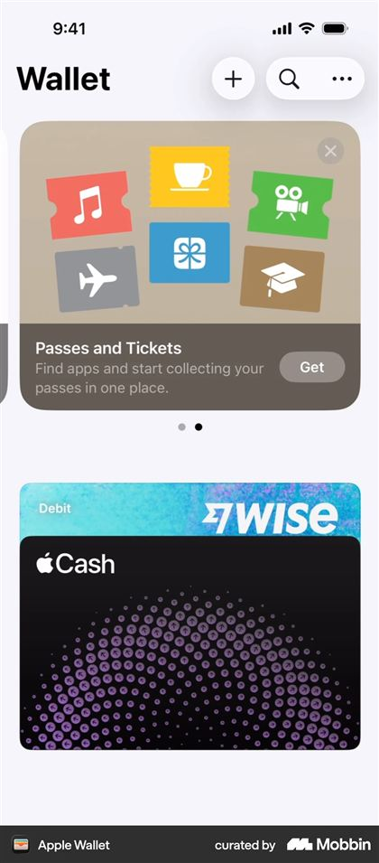

# Bingd — Design System

**Version:** v3
**Status:** Draft for founder review
**Date:** 2026-11-14 (v2 was 2026-08-15, v1 2026-08-13)
**Specification:** [`../product/PRD.md`](../product/PRD.md) §5, §10 · [`../architecture/client.md`](../architecture/client.md) §4
**Companions:** [UI review checklist](./ui-review-checklist.md) · [PR template](../../.github/pull_request_template.md) · agent guidance in [`.agents/skills/expo-design-system/references/bingd-design-system-v3.md`](../../.agents/skills/expo-design-system/references/bingd-design-system-v3.md)

The PRD fixes the palette, the typefaces and the voice. This document turns them into values a
component consumes and rules a screen is reviewed against. It is the one design guide in the
repository: [`screens.md`](./screens.md), [`ui-pass-plan.md`](./ui-pass-plan.md) and
[`ui-pass-handoff.md`](./ui-pass-handoff.md) are historical, and where they disagree with this file,
this file wins.

## How to read v3

- **Code is the source of every value.** Each number, token and component below cites the file and
  line that implements it on the base `claude/imp1113-base@288c5e19`. Values that exist only on an
  open reference branch say so and name the branch and PR (for example _pending #289_). Where the
  code does not settle a question, the text says **not specified in code** rather than guessing.
- **Every rule is tagged.** **[Universal]** applies everywhere. **[Exception: …]** names the one
  surface allowed to differ and why. A new exception needs a founder decision, an entry in the
  section it bends, and a line in the PR (see the [checklist](./ui-review-checklist.md) A7).
- **Superseded rules stay visible.** A v2 rule that a later decision replaced is marked
  **Superseded in v3:** with the decision and its date, rather than deleted, because the reasoning
  behind a rule is worth more than the rule. Appendix A lists every v2 rule and its status.

## What changed in v3 (vs v2, 2026-08-15)

1. **Restructured into 17 sections** (principles to component inventory). Appendix F maps every v2
   section number to its v3 home, so `design-system.md §N` references in code comments still resolve.
2. **The FU1113-B shared contracts** (commit `8f256130`, 2026-11-13) are documented for the first time:
   `ScoreCircle`, `SeasonAverageBadge` / `seasonAverageBadgeText`, `FilterIconButton`, `ViewModeToggle`,
   `BrowseControlsRow`, `Sheet size="standard"` with `DismissFooter`, `EditIcon` / `EditAction`, and
   `theme.layout.section`.
3. **The November 2026 founder decisions** are written as rules (§3, §5, §6, §9, §10, §13, §14).
4. **The twelve component rules** (§17.1) are stated once, each pointing at its implementing component.
5. **Components on open branches** are recorded with their status: `Disclosure` and `ActionPair`
   (pending fourwardhabits/bingd#289), Button `inset="snug"` (pending fourwardhabits/bingd#292),
   `ReviewCard` (pending fourwardhabits/bingd#293), `BrowseControlsRow` adoption (pending
   fourwardhabits/bingd#291).
6. **Superseded in v3** (each marked in place): `IconToggle` as Collection's Poster/List control,
   the 90% sheet cap and "sheet heights are not unified", the dashed unranked ring, the trailing score
   badge on title rows, "row edit affordances are small text", "never an average across users", and
   others listed in Appendix A.
7. **Agent and review guidance** now exists: the skill reference and the UI review checklist.

---

## 1. Principles and hierarchy

### 1.1 Seven principles [Universal]

1. **One visual source of truth.** Every colour, size, space and type value comes from
   `src/ui/tokens/` through `theme` (`src/ui/tokens/theme.ts:44`, `useTheme` at `:50`). The only file
   allowed a colour literal is `src/ui/tokens/color.ts:1-6`, enforced by lint (`eslint.config.js`).
2. **Reuse before you build.** A control that exists in the inventory (§17) is used, not copied. Two
   controls that behave alike and look merely similar drift into two dialects at the next tuning pass.
3. **One primary per context.** The Maroon fill marks the primary action of the _current context_.
   Never two equally dominant Maroon CTAs in one view (§5.3).
4. **Quiet things stay quiet.** Exits, alternatives and secondary navigation are tertiary text
   actions, not a second set of buttons (§5.4).
5. **The relationship, not the number.** Every seam between two components is explained by a named
   interval (§4), not by an inline margin chosen to make one screenshot look right.
6. **Measured, not eyeballed.** Contrast is a test (§2.6); pair layout is a computation (§6); tap
   targets are asserted (§7).
7. **Works at 320pt and at fontScale 2 on both platforms**, or it is a bug (§6, §16).

### 1.2 Three problems in the palette (v2 §1, still valid)

All three were found by measuring the PRD §5 colours rather than by looking at them, and all three
are still pinned by `src/ui/tokens/contrast.test.ts`.

**Antique Amber and Muted Sage cannot carry text.** On Paper `#FBF8F4`, Amber measures 2.1:1 and Sage
2.4:1 (on Parchment 1.9:1 and 2.2:1) — below even the 3:1 large-text floor
(`contrast.test.ts:92-104`). They are **fill colours, never ink**. Where amber emphasis is wanted,
amber is the surface and Ink sits on it at 7.0:1 (`contrast.test.ts:76-82`; the goal bar's completed
fill is the remaining instance). This corrected `client.md` §5, which had specified Amber for the
reveal's ordinal.

**Posters fought Parchment, and Parchment lost.** Parchment `#F5EBDD` was the base surface until
2026-08-15; artwork became loud objects on a quiet page. The base is now **Paper `#FBF8F4`**
(`color.ts:12`), and Parchment moved _down the stack_ to `surface.sunken` (`color.ts:49`): wells,
inputs, chips, selected states, placeholders, share cards. Posters remain printed objects: 2:3,
hairline Ink border, soft warm shadow, real margins (§12).



Two v1 absolutes were relaxed by name in v2 and remain relaxed: the score badge is chromatic on
every row, and the title-page hero is the one full-bleed surface.

**Stone is not quite a neutral.** Stone `#9A8F86` (`color.ts:154`) measures 3.0:1 on Paper
(`contrast.test.ts:106-112`): legible enough as a border to look like it might work as text, and it
does not. It is a fill; its certified pair is Ink on top at 4.9:1.

### 1.3 Hierarchy on a screen [Universal]

From top to bottom, a screen's voice is: the app or navigation header (§8) → an optional content
header row (a `SectionHeader` or section-sized `MediumSelector` on the left, at most one control on
the right) → browse controls (§9) → content (§12, §13). Maroon is spent on, in order: the score (§11),
the one primary action (§5), section headers (§3), and a selected state. A screen where three
unrelated things are Maroon has no hierarchy left to spend.

---

## 2. Colour and semantic roles

All values: `src/ui/tokens/color.ts`. Contrast ratios: computed by `src/ui/tokens/contrast.ts`
(`contrastRatio` at `:44`, WCAG thresholds `WCAG.AA_BODY 4.5`, `AA_LARGE 3`, `AA_NON_TEXT 3` at
`:52-59`) and pinned to the printed value by `src/ui/tokens/contrast.test.ts`.

### 2.1 Brand — fixed by PRD §5 (`color.ts:9-20`)

| Token             | Value     | Role                                          |
| ----------------- | --------- | --------------------------------------------- |
| `brand.paper`     | `#FBF8F4` | The base surface since 2026-08-15             |
| `brand.parchment` | `#F5EBDD` | Warm accent: `surface.sunken`, `text.inverse` |
| `brand.maroon`    | `#773744` | Action, score, section headers, focus         |
| `brand.ink`       | `#242326` | Text, borders and shadows (never black)       |
| `brand.amber`     | `#D4A64C` | Milestone fills only                          |
| `brand.sage`      | `#92A895` | Progress fills only                           |
| `brand.midnight`  | `#19242D` | Reserved for a future dark theme; unused      |

`inkAlpha(a)` (`color.ts:24`) builds every border and shadow; `paperAlpha(a)` (`color.ts:33`) is the
title hero's scrim — Paper going opaque, never black going transparent.

### 2.2 Surfaces (`color.ts:44-50`)

| Token            | Value     | Use                                                           |
| ---------------- | --------- | ------------------------------------------------------------- |
| `surface.base`   | Paper     | Screen background                                             |
| `surface.raised` | `#FFFFFF` | Cards, sheets, buttons, anything above the page               |
| `surface.sunken` | Parchment | Inputs' wells, selected chips, skeletons, poster placeholders |

A card lifts by going toward white; a well recedes by going toward Parchment.

### 2.3 Text (`color.ts:66-76`) and borders (`color.ts:52-55`)

| Token            | Value     | On Paper | On Parchment | Use                                   |
| ---------------- | --------- | -------- | ------------ | ------------------------------------- |
| `text.primary`   | Ink       | 14.8:1   | 13.3:1       | Default                               |
| `text.secondary` | `#5F5A56` | 6.4:1    | 5.8:1        | Supporting copy, quiet actions        |
| `text.tertiary`  | `#6E6862` | 5.2:1    | 4.7:1        | Timestamps, counts, metadata          |
| `text.onFill`    | Ink       | —        | —            | Ink on Amber 7.0, Sage 6.1, Stone 4.9 |
| `text.inverse`   | Parchment | —        | —            | Parchment on Maroon 7.4:1             |

Ratios: `contrast.test.ts:23-40`. `text.tertiary` on Parchment (4.7:1) is the tightest pair in the
system; there is deliberately **no fourth, lighter text tone** (`color.ts:63-64`,
`contrast.test.ts:115-124`) — the honest fix for "less important" is smaller type or more space.

Borders: `border.hairline` = Ink @ 12% (default separation, poster edges); `border.strong` = Ink @ 24%
(input and secondary-button outlines, focus).

`Text` exposes these as `tone`: `primary | secondary | tertiary | inverse | onFill | action`, where
`action` is `semantic.action` (`src/ui/components/Text.tsx:10`, `:25-26`).

### 2.4 Semantic roles (`color.ts:78-141`)

| Token                   | Value     | Role                                                                                                      |
| ----------------------- | --------- | --------------------------------------------------------------------------------------------------------- |
| `semantic.action`       | Maroon    | Primary buttons, links, selected, `tone="action"`                                                         |
| `semantic.actionText`   | Parchment | Label on an action fill                                                                                   |
| `semantic.score`        | Maroon    | Every stated 0–10 score. Named apart from `action` so a change to one never repaints the other (`:81-92`) |
| `semantic.scoreInk`     | Parchment | Numerals on `score`, 7.4:1 (`contrast.test.ts:70-74`)                                                     |
| `semantic.scoreEmpty`   | `#D9D6D3` | The score-shaped hole: a filled grey disc with nothing in it (`:94-113`)                                  |
| `semantic.actionSubtle` | `#CDB4B6` | Maroon at border weight for an emphasised (feature) control, never the selected state (`:114-132`)        |
| `semantic.emphasis`     | Amber     | Milestone fills. Never text                                                                               |
| `semantic.progress`     | Sage      | Watched, completed, sync success. Never text                                                              |
| `semantic.danger`       | Maroon    | Destructive confirmation; always confirmed with a verb, never colour alone                                |
| `semantic.focusRing`    | Maroon    | Focus                                                                                                     |

`scoreEmpty` and `actionSubtle` are resolved literals, not alpha helpers, because both sit on Paper and
on Parchment and an alpha fill takes its colour from whatever is behind it.

### 2.5 Buckets and the certified fills (`color.ts:151-168`)

| Bucket           | Fill token                        | Score range | Ink                         | Ratio |
| ---------------- | --------------------------------- | ----------- | --------------------------- | ----- |
| I liked it       | `bucket.loved` Maroon             | 10.0–7.0    | `bucketInk.loved` Parchment | 7.4:1 |
| It was fine      | `bucket.fine` Sage                | 6.9–3.5     | `bucketInk.fine` Ink        | 6.1:1 |
| I didn’t like it | `bucket.notForMe` Stone `#9A8F86` | 3.4–0.0     | `bucketInk.notForMe` Ink    | 4.9:1 |

Ratios pinned at `contrast.test.ts:51-62`. These, the score pair, Amber + Ink, and the medals below
are the **certified fills**: the only places a brand colour carries text. Nothing else may be used as a
fill behind a label without being measured and added to `contrast.test.ts` first. [Universal]

Not red/yellow/green: that triad judges the film rather than the viewer's response, and it fails for
red-green colour vision deficiency. Amber is excluded from the buckets because its job is
celebration. **Colour is never the only signal**: every bucket indicator carries its label or a number
that states the same thing.

### 2.6 Decorative and partner colours

- `tier` (`color.ts:187-193`): award tier dots, decorative only, never text.
- `medal` (`color.ts:207-211`): the Leaderboard's filled rank badges; each pair carries a numeral and
  is asserted at AA (`contrast.test.ts:127-131`).
- `partnerMark` (`color.ts:225-228`): Letterboxd and IMDb logo colours, for the import provider choice
  only (`src/features/import/ProviderLogo.tsx`). Never bingd's palette.

### 2.7 Keeping colour honest [Universal]

Three mechanisms (v2 §11, still valid): **a contrast test** (above) that runs every text tone against both
Paper and Parchment; **a score test** asserting the PRD §10 derivation's three edges (a band of one, the
bottom of a band, the boundary between bands); and **a lint rule banning raw colour literals** in
`src/features/` and `src/ui/`, so a hardcoded `#D4A64C` cannot reintroduce the exact defect §1.2 opens with.

---

## 3. Typography

All values: `src/ui/tokens/typography.ts`.

### 3.1 Families (`typography.ts:9-15`)

**DM Serif Display** (`fontFamily.serif`, `serifItalic`) ships Regular and Italic only — there is no
bold, so serif emphasis comes from size and space, never weight. **Inter** at 400 (`sans`), 500
(`sansMedium`) and 600 (`sansSemibold`); not 700. Both are bundled locally and never fetched.

### 3.2 Tokens (`typography.ts:21-106`)

| Token                | Family    | Size / line              | Use                                                                      | Line      |
| -------------------- | --------- | ------------------------ | ------------------------------------------------------------------------ | --------- |
| `reveal`             | DM Serif  | 88 / 88, cap 1.3×        | The ranking reveal's score. Nowhere else                                 | `:23-28`  |
| `display`            | DM Serif  | 40 / 44, cap 1.3×        | Share cards, milestone moments                                           | `:29-34`  |
| `title1`             | DM Serif  | 28 / 34                  | Editorial screen titles; the title-size `MediumSelector`                 | `:35`     |
| `title2`             | DM Serif  | 22 / 28                  | Title names; `SheetHeader`                                               | `:36`     |
| `headline`           | Inter 600 | 17 / 22                  | Row titles, `md` button labels                                           | `:37`     |
| `body`               | Inter 400 | 16 / 24                  | Notes, descriptions, prose                                               | `:38`     |
| `bodySecondary`      | Inter 400 | 15 / 22                  | Secondary prose under a title or date (a list description, a watch note) | `:45`     |
| `callout`            | Inter 500 | 15 / 20                  | Secondary actions, `sm` button labels                                    | `:46`     |
| `subhead`            | Inter 500 | 14 / 20                  | Field labels, metadata headers, `SaveButton` size                        | `:47`     |
| `footnote`           | Inter 400 | 13 / 18                  | Timestamps, counts, `DismissFooter` label                                | `:48`     |
| `caption`            | Inter 500 | 12 / 16, +0.2            | Overlines, tab labels, `SN AVG` badge                                    | `:49-54`  |
| `score`              | Inter 600 | 17 / 20, tabular         | Reference metrics for a score numeral                                    | `:60-65`  |
| `ordinal`            | Inter 600 | 15 / 20, tabular         | Ordinals and rank columns                                                | `:66-71`  |
| `sectionHeader`      | Inter 600 | 12 / 16, +0.6, uppercase | Section headers, in Maroon                                               | `:78-84`  |
| `sectionHeaderLarge` | Inter 600 | 15 / 20, +0.7, uppercase | Feed and Profile tab headings, the Settings index only                   | `:99-105` |

`inputText` (`typography.ts:120-124`) is `body` without its line height and with `paddingVertical: 0`,
for single-line `TextInput`s, so the glyphs centre on iOS and Android.

### 3.3 Rules

- **DM Serif Display only for approved editorial headings; Inter everywhere else** [Universal]
  (founder, November 2026). "Approved" means the uses in the table above: the reveal, share and
  milestone moments (`display`), editorial screen titles and the title-size medium selector (`title1`),
  title names and sheet titles (`title2`). Controls, rows, buttons, metadata, section headers, chips and
  badges are Inter. A new serif heading needs the founder's approval and a row in the table.
- **No oversized headers** [Universal] (founder, November 2026). Use the existing token for the
  heading's role; never a one-off `fontSize`, never `display` where `title1`/`title2` serves. Applied on
  base to the Settings header, where an oversized gap was removed (founder QA 2026-11-12,
  `app/settings/index.tsx:54-60`).
- **Serif usage that this rule has not yet been checked against** (recorded, not changed): every import
  page heading uses `display` 40pt (`src/features/import/ImportScreen.tsx:545`, and the new
  `ImportIntro` / `PreviewSummary` / `CompletionSummary` on #289 keep it); the sign-in hero
  (`app/(auth)/sign-in.tsx:147`); `ScreenError`'s `title1` (`src/ui/components/ScreenError.tsx:60`);
  `EmptyState`'s `title2` (`src/ui/components/EmptyState.tsx:40`). Whether these are "approved
  editorial headings" is an open founder decision (Appendix G.1), not something this guide decides.
- **`sectionHeaderLarge` is reached only through `SectionHeader size="large"`**
  (`src/ui/components/SectionHeader.tsx:123`), scoped by name to the Feed and Profile tab headings and
  the Settings index (`typography.ts:85-98`). Everywhere else keeps 12pt.
- **Section headers are Maroon `sectionHeader`**, not `subhead` in `text.tertiary`; at 5.2:1 the old
  treatment read as a disclaimer rather than structure (`typography.ts:72-77`).
- **`score` is tabular and Inter**, never serif: a serif score reads as editorial rather than data.
- **`bodySecondary` is for secondary prose only** — never titles, dates, actions or controls
  (`typography.ts:39-45`).

### 3.4 Text scaling [Universal]

`Text` (`src/ui/components/Text.tsx`) is the only text primitive. Only `reveal` and `display` cap at
130% (`maxFontSizeMultiplier: 1.3`, `typography.ts:27`, `:33`); every other token scales without a
ceiling and never below 100% (`Text.tsx:17-23`). Layouts that break at 200% are bugs. Components that
cap themselves do so deliberately and say why: score numerals scale with the circle and cap at 1.3×
(§11), `SaveButton`'s label caps at 1.3× (§5), and poster-tile chips do not scale (§12).

---

## 4. Spacing, gutters and section rhythm

All values: `src/ui/tokens/layout.ts`.

### 4.1 The scale (`layout.ts:4-29`)

```ts
space = { 1: 4, 2: 8, 3: 12, 4: 16, 5: 20, 6: 24, 7: 28, 8: 32, 10: 40, 12: 48, 16: 64 };
```

A 4pt base. `space[7]` (28) is the section interval of a reading page, added 2026-09-07 (`:11-24`).

### 4.2 Named layout values (`layout.ts:31-60`)

| Token                              | Value | Use                                                                                            | Line  |
| ---------------------------------- | ----- | ---------------------------------------------------------------------------------------------- | ----- |
| `layout.gutter`                    | 16    | Minimum Paper on every screen edge; sheet content's inset                                      | `:34` |
| `layout.sectionGap`                | 24    | One section interval                                                                           | `:35` |
| `layout.section.above`             | 16    | A section's top edge to whatever ends above it (a sheet's handle or title, the previous block) | `:51` |
| `layout.section.headingToControls` | 8     | A section heading to its own controls                                                          | `:52` |
| `layout.section.controlsToContent` | 12    | Those controls to the content they act on                                                      | `:53` |
| `layout.section.between`           | 24    | One section's end to the next heading (equals `sectionGap`)                                    | `:54` |
| `layout.cardPadding`               | 16    | Card padding                                                                                   | `:56` |
| `layout.rowMinHeight`              | 56    | Efficient-surface rows                                                                         | `:58` |

`theme.layout.section` (FU1113-B, 2026-11-13, `layout.ts:37-55`) is a vocabulary rather than new
numbers: screens that agreed by hand now agree by name. `SectionHeader` exposes it as
`sectionSpacing` (`src/ui/components/index.ts:111`).

### 4.3 Screen rhythm: every adjacent pair has a stated relationship [Universal]

| Seam                                           | Interval | Token                                               |
| ---------------------------------------------- | -------- | --------------------------------------------------- |
| Screen or header → the first controls under it | 16       | `space[4]` / `section.above`                        |
| Section heading → its own controls             | 8        | `section.headingToControls`                         |
| Control row → the content it governs           | 12       | `section.controlsToContent` (12–16 with `space[4]`) |
| Major section → the next                       | 24–28    | `section.between` / `space[7]`                      |
| Compact, closely related controls              | 8–12     | `space[2]`–`space[3]`                               |

**The rule is the relationship, not the number** (v2, 2026-09-08). Where two components could each own
a seam (a scroller's `paddingBottom` and a list's `paddingTop`), exactly one owns it and says so in a
comment. This is not a licence to re-space screens nobody has complained about.

### 4.4 November decisions on vertical space

- **No oversized gaps above headers** [Universal] (founder QA 2026-11-12). A screen under a native-stack
  header does not add `Screen`'s top edge a second time (`app/settings/index.tsx:54-60`); the first
  section keeps only the ordinary section interval.
- **Filter-sheet top spacing** [Universal for filter sheets] (FU1113-B). The first section sits
  `section.above` below the drag handle, and every pair of sections is `section.between` apart, so no two
  seams differ (`src/features/collection/CollectionFilterSheet.tsx:264-273`, pinned by
  `src/features/collection/CollectionFilterSheet.spacing.test.tsx`). The person page's Filmography and
  the Profile Collection sheet adopt the same names on FU1113-C (pending #291).

### 4.5 Layout invariants (v2 §5, canonical 2026-09-14, still valid)

| Layer                                   | Horizontal edge                                                                             | Vertical rule                                                                                    |
| --------------------------------------- | ------------------------------------------------------------------------------------------- | ------------------------------------------------------------------------------------------------ |
| **Sheet container** (`Sheet`)           | Edge to edge; `Sheet` pads nothing sideways                                                 | Size and bottom inset per §10                                                                    |
| **Sheet content**                       | `layout.gutter`, applied once by the content's wrapper                                      | `section.above` (filter sheets) or `space[2]` below the handle                                   |
| **Page content** on a `Screen`          | `layout.gutter`, applied once                                                               | Seams per 4.3                                                                                    |
| **Media** (posters, backdrops, shelves) | May run edge to edge; a shelf's first item starts at the gutter via `contentContainerStyle` | n/a                                                                                              |
| **Fixed footers**                       | `layout.gutter`                                                                             | Keep the bottom safe area: `Sheet` supplies it in a sheet; `Screen includeBottomInset` on a page |
| **Scroll body**                         | Pads through `contentContainerStyle`, not `style`                                           | The final item scrolls fully into view above any footer                                          |

1. **One owner per gutter.** `Sheet` stays unpadded; a sheet's content wrapper sets
   `paddingHorizontal: theme.layout.gutter`.
2. **A sheet that can outgrow its height scrolls inside it**: a wrapper with `flexShrink: 1`, a
   `ScrollView` with `style={{ flexGrow: 0, flexShrink: 1 }}`, and the footer outside the scroll view.
3. **No giant spacers.** Do not use `flex: 1` or `justifyContent: 'space-between'` to pin actions under
   a short block of text.
4. **No stale offsets on a state switch.** A screen that swaps whole phases in place keys its scroll
   view by phase.
5. **Use the shared primitives** — `Screen`, `Sheet`, `layout.gutter`, `space` — never device checks or
   measured-height hacks.
6. **Chips and labels wrap**: `flexDirection: 'row', flexWrap: 'wrap', gap: space[2]`, each chip
   `maxWidth: '100%'`.

Tests hold these rules where they were broken: `GenreRow.test.tsx` (sheet inset, wrapping, long labels,
shrinking scroll), `MatchExplainer.test.tsx` (sheet inset), `HowToExportSheet.test.tsx` (inset, footer
outside the scroll, bottom padding; retired on #289 when the export help became the inline `Disclosure` in
`ExportHelp.tsx`), and `ImportScreen.test.tsx` with `LetterboxdStep.test.tsx` (a fresh scroll body per
phase). A new sheet or phase-switching screen adds the equivalent assertion.

**The bottom edge belongs to whatever is at the bottom** (v2, 2026-08-15). `Screen` adds bottom padding
only when asked (`includeBottomInset` → `max(insets.bottom, 16)`); tab screens ask for none, and the tab
bar paints `surface.raised` behind Android's edge-to-edge navigation buttons.

### 4.6 Radius and elevation (`layout.ts:161-185`)

Radius: `card` 12, `control` 8 (buttons, inputs, chips), `sheet` 20 (top corners), `full` 9999 (avatars
only). **No pill buttons** — PRD §5 (`layout.ts:160`). Elevation: `e1` (0 1px 2px Ink @ 6%) for raised
cards and posters ≥ `md`; `e2` (0 8px 24px Ink @ 14%) for sheets and popovers — Ink, never black.
Motion durations: `duration.state` 120, `sheet` 200, `navigation` 260 (`layout.ts:187-193`).

---

## 5. Buttons

### 5.1 `Button` (`src/ui/components/Button.tsx`)

|                    | Value                                                                                                                                                            | Line                |
| ------------------ | ---------------------------------------------------------------------------------------------------------------------------------------------------------------- | ------------------- |
| Kinds              | `primary` · `secondary` · `tertiary` · `outline` (default `primary`)                                                                                             | `:21`, `:95`        |
| Sizes              | `md` (default) · `sm`                                                                                                                                            | `:32`, `:96`        |
| `md`               | `minHeight` `layout.buttonMinHeight` 48, `paddingHorizontal` `space[5]` 20, label `headline`                                                                     | `:152`, `:128`      |
| `sm`               | `minHeight` `control.compactAction.visibleHeight` 36, `paddingHorizontal` `space[4]` 16, label `callout`                                                         | `:153-156`, `:128`  |
| All                | `radius.control` 8, centred content                                                                                                                              | `:147-151`          |
| `primary`          | Fill `semantic.action`; label `text.inverse`                                                                                                                     | `:157`, `:130-131`  |
| `secondary`        | `surface.raised`, `hairlineWidth*2` `border.strong` outline; Ink label                                                                                           | `:158-162`          |
| `tertiary`         | Transparent, no border, `paddingHorizontal` `space[2]`; keeps the size's height; Ink label                                                                       | `:163`              |
| `outline`          | `surface.raised`, 2pt Maroon border, Maroon label (ignores `tone`) — the filled button's settled state (_Following_, _Requested_), not a primary with a modifier | `:7-19`, `:167-171` |
| `tone`             | `default` · `secondary` — a quieter label (`text.secondary`) for non-primary kinds only                                                                          | `:34-47`            |
| `fit`              | One line, `adjustsFontSizeToFit`, `minimumFontScale` 0.85, `paddingHorizontal` `space[3]`                                                                        | `:125-127`, `:173`  |
| Pressed / disabled | Opacity 0.85 / 0.4                                                                                                                                               | `:174-175`          |
| `inset`            | `standard` · `snug` (`paddingHorizontal: space[2]`), default `standard` — **pending #292** (`claude/fu1113-d-season-completion@a724d1de`)                        | —                   |

There is **no `loading` state** on `Button`: callers swap the label (for example _Saving…_). There is no
press scale and no haptic, deliberately: callers assert `Button`'s parentage in layout tests
(`src/ui/interaction.test.tsx`), and a wrapper would break them (Appendix C).

### 5.2 The other button-shaped controls

- **`SaveButton`** (`src/ui/components/SaveButton.tsx`) — the **compact Maroon save** [Universal for an
  explicit save] (founder spec §2A, 2026-11-13). Fill `semantic.action` (`:123`), visible height
  `control.compactAction.visibleHeight` 36 (`:120`), `paddingHorizontal` `compactAction.paddingHorizontal`
  12 (`:121`), radius `control` (`:122`); label `subhead` size in Inter SemiBold, Parchment, one line,
  capped at 1.3× (`:95-100`, `:127`); the outer pressable is a full 44 × 44 box, not slop, "because
  Android clips touches" (`:41-44`, `:113-118`). `saving` shows _Saving…_ and announces `busy` (`:81`,
  `:103`); a 600ms repeat guard makes a double tap one save (`:27`, `:67-73`). No icon.
- **`MiniButton`** (`src/ui/components/MiniButton.tsx`) — secondary chrome that shrink-wraps, 44pt
  high, Maroon `callout` label and optional icon (`:80-93`). **No callers on base**; not for a primary
  CTA, a ranking flow's _Done_, Recommend or Share (`:34-35`).
- **`DismissFooter` / `SheetDone`** — the quiet Close at the foot of a sheet. See §10.
- **`EditAction`** — the edit affordance. See §7.

### 5.3 Which kind an action takes (v2 canonical 2026-08-27, still valid) [Universal]

The Maroon fill marks **the primary action of the current context**. On a title page that is the
Rank/Ranked control, so Recommend in the action row is icon-only and quiet there, and filled again
inside the Recommend sheet where sending _is_ the primary act. **Never two equally dominant Maroon
CTAs in one view.** Filled: Follow, accept-shaped actions (Approve, Add), bingd Awards, the primary of
a pair. Outlined or quiet: Share Profile, Following (`outline`), Share off bingd, Watchlist,
Cancel / Close / Dismiss, filters and settings. Apply it narrowly: it is a judgement about a context,
not a licence to repaint every control that feels important.

### 5.4 November decisions

- **Reuse shared `Button` kinds; no one-off primary or secondary styles** (rule 1, §17.1) [Universal].
- **Quiet tertiary actions** [Universal] (founder, November 2026). An exit, an alternative or secondary
  navigation is `Button kind="tertiary"`, usually `tone="secondary"` and `size="sm"`, centred in its own
  row, with vertical slop to 44pt. Implemented on base by _Keep Show_ under the reveal pair
  (`src/features/ranking/RankingSheet.tsx:2466-2479`, centred by `revealKeep` at `:2790`) and on #289 by
  _Choose a different file_ (`src/features/import/PreviewSummary.tsx:84-94`, `QUIET_SLOP` at `:101-104`,
  `claude/imp1113-import-ux@52e9d1d3`). See rule 8.
- **Compact Maroon `SaveButton`** [Universal] for every explicit save in a header or editing surface.
  Known bypasses on base (code defects, not exceptions): `src/features/goals/GoalSheet.tsx:142-145` and
  `src/features/lists/EditListSheet.tsx:173` build a _Saving… / Save_ `Button` by hand.

### 5.5 Disabled actions [Universal]

Disabled is opacity 0.4 **and** a spoken reason: `Button` takes `disabledReason` and speaks it as the
hint (`Button.tsx:111`), warning in development when it is missing (`:103-105`). An unexplained dead
button is the most common accessibility failure in this pattern. Actions that cannot be queued
offline (ranking, blocking, reporting) are visibly disabled with a reason rather than failing on tap.

---

## 6. Action pairs, responsive stacking, truncation and text scaling

### 6.1 The pair rule (v2 canonical 2026-08-27, restated) [Universal]

- **Side by side when width permits; stacked primary-first otherwise** (rule 7, §17.1). In a row, two
  equal halves (`flex: 1` each), the secondary act leading and the Maroon primary trailing, both
  `fit`. Below the width where both labels fit at their natural size, two full-width rows with the
  **primary on top** — never shrink one half to buy the other room.
- **`fit` on both, always.** Without it a label wraps, and a label with nowhere to wrap breaks
  mid-word (the founder's Android screenshot read `Share off bi / ngd.`).
- **Decide the layout from the viewport, not from `flexWrap`.** Yoga gives a flex child no automatic
  minimum size, so a wrap that would have saved a label never fires. Read `useWindowDimensions()` width
  and `fontScale` and choose.
- **A label that cannot fit its half is a copy decision**, not a layout one.

`ProfileActions` (`src/features/profile/ProfileActions.tsx`, pinned by `ProfileActions.test.tsx:52-88`)
is the reference row on base.

> **Superseded in v3:** v2 §11b's "Not two full-width stacked bars" read as absolute. The 2026-08-27
> rule it summarised already stacked below the fit width; v3 restores that wording (founder rule 7,
> 2026-11-13).

### 6.2 `ActionPair` — the shared pair (pending #289)

`src/ui/components/ActionPair.tsx` on `claude/imp1113-import-ux@52e9d1d3` implements 6.1 as one
component:

- Props `secondary`, `primary` (`PairAction {label, onPress, accessibilityHint?, testID?}`),
  `secondaryKind?: 'secondary' | 'outline'` (default grey outline), `horizontalInset?` (default
  `layout.gutter * 2`), `pinned?` (pads the bottom by `max(insets.bottom, space[4])`) (`:7-35`).
- Decides from the viewport (`:68`): each half is `(width − horizontalInset − space[2]) / 2`, and every
  label must fit it at `em × 17 × fontScale × 1.04 + space[3]×2 + 4` (`:138-158`). Label widths come from
  `PAIR_LABEL_EM`, measured from Inter SemiBold (`:123-127`); an unmeasured label counts 0.65 em per
  character so it errs toward stacking (`:128-132`).
- Row: `[secondary, primary]`, `gap: space[2]`, `alignItems: 'stretch'`, halves `flex: 1`, both `fit`.
  Stack: `[primary, secondary]`, full width, labels may wrap (`:77-113`, `:160-164`).
- Tests: row at 360pt/1×, stack primary-first at 320pt/2×, the fit table monotonic in `fontScale`
  (`ActionPair.test.tsx` on #289).

### 6.3 Exception: `RankingSheet`'s measured reveal pair [Exception: RankingSheet]

The reveal's season decision (_Add details_ | _Update Show …_, with _Keep Show …_ quiet underneath) is
**the sheet's own measured pair, not `ActionPair`**. `ActionPair` says why: "those are the sheet's own,
measured against its own labels and its own bounded body, and lifting them out would reshape a shipped
flow" (`ActionPair.tsx:56-58`, #289).

- **Base:** `sm` buttons at natural widths (`revealExitNatural {flexGrow: 0}`), stacked primary-first
  when `compactExitsFitRow` fails, measured arithmetically from a per-character table — no `onLayout`
  (`src/features/ranking/RankingSheet.tsx:1963-2002`, `:2656-2689`).
- **#292** (`claude/fu1113-d-season-completion@a724d1de`): labels become _Update Show Ranking_ /
  _Keep Show Ranking_ with no score; the pair is `md` with `inset="snug"`, each half's `flex` in
  proportion to its label's measured width; stack order _Update Show Ranking_, _Add details_,
  _Keep Show Ranking_.

**Convergence follow-up:** the reveal pair should converge on `ActionPair` (or `ActionPair` should gain
the proportional mode) once #289 and #292 land. Until then it is the only sanctioned pair that does not
use equal halves.

### 6.4 Truncation [Universal]

- Labels never truncate mid-word. A one-line control uses `fit` (`Button`, `minimumFontScale` 0.85) or a
  `SectionHeader` `fit` (`minimumFontScale` 0.6, `SectionHeader.tsx:128-130`); otherwise text wraps.
- A row of browse controls truncates its **leading** side, never the trailing controls
  (`BrowseControlsRow.tsx:20-24`; the leading child sets `numberOfLines`).
- Row metadata may be one line (`TitleRow` secondary `numberOfLines 1`, `TitleRow.tsx:98`); a title may
  take two (`:93`).
- `ContentToolbar`'s title never truncates; its tools wrap onto a line of their own
  (`ContentToolbar.tsx:17-19`).

### 6.5 Text scaling and narrow widths [Universal]

- Every layout is checked at **320pt** width and **fontScale 2** (the smallest supported phone at the
  largest accessibility size). In jest, mock `useWindowDimensions` and assert the row/stack decision;
  FU1113-C adds a shared helper for it (`test-utils/narrow-row.ts`, pending #291).
- Components that compute layout from the window: `ActionPair` (6.2), `RankingSheet` (6.3),
  `ImmersiveScores` (stacks when `width / fontScale < 290`, `src/features/title/ImmersiveScores.tsx:61`,
  `:71`), `PosterGrid` card width (`PosterWall.tsx:195`), `MediumSelector` marquee type
  (`marqueeType(width)`, 21pt under 360, 23pt at 412 and up).
- Fixed-size artwork never grows with type; the row grows around it (§12).

---

## 7. Icons and touch targets

### 7.1 Icons (`layout.ts:72`)

`layout.icon` = `sm` 20 · `md` 24 · `lg` 28. Every glyph is Ionicons (`@expo/vector-icons`); `SheetRow`'s
`icon` is typed to Ionicons names (`src/features/watch-history/rerank.ts:7-11`). Icons inherit
`text.secondary` when quiet and `semantic.action` when on or emphasised.

| Meaning                 | Glyph                                                                      | Source                                                                                               | Status |
| ----------------------- | -------------------------------------------------------------------------- | ---------------------------------------------------------------------------------------------------- | ------ |
| **Edit**                | `create-outline` (square with pencil)                                      | `EDIT_ICON_NAME`, `src/ui/components/EditIcon.tsx:12`                                                | Rule 4 |
| **Rerank**              | `swap-horizontal-outline` (horizontal bidirectional arrows); word _Rerank_ | `RERANK_ICON` / `RERANK_LABEL`, `src/features/watch-history/rerank.ts:15`, `:18`                     | Rule 5 |
| **Rank** (first time)   | `star-outline` — the initial Rank only; nothing that reranks may use it    | `rerank.ts:13`; `src/ui/components/PersonalState.tsx:105`, `src/features/title/TitleActions.tsx:253` |        |
| **Filters**             | `options-outline`                                                          | `src/ui/components/FilterIconButton.tsx:64`                                                          | Rule 3 |
| **Sort (no direction)** | `swap-vertical-outline`                                                    | `src/ui/components/SortControl.tsx:62-67`                                                            |        |
| **Poster / List view**  | Grid / list glyphs                                                         | `src/ui/components/ViewModeToggle.tsx:18-21`                                                         | Rule 2 |

**Rule 4 — Edit is the square-with-pencil.** [Universal] `EditIcon` (`size` `sm` 20 / `md` 24, colour
`semantic.action` by default, hidden from accessibility, `EditIcon.tsx:14-31`) and `EditAction` (a
≥ 44 × 44 pressable with a required `accessibilityLabel` and an optional `subhead` Maroon label,
`:35-80`). "Never for Rerank, Rank, Add, Bookmark, Share or Delete" (`:9-10`). **Implementation status
on base:** `EDIT_ICON_NAME` is used by `LogSheet` (`src/features/collection/LogSheet.tsx:1873`) and
Settings (`app/settings/index.tsx:128`); `EditIcon` / `EditAction` have no callers on base (`EditAction`
is adopted for a reader's own review on #293). Six `create-outline` literals bypass the constant and
one puts it on a Rank verb (Appendix A, code defects).

> **Superseded in v3:** v2 §11b "Row edit affordances are small text (`Edit`, optionally with a small
> pencil), never a large bare glyph". Replaced by rule 4 (FU1113-B, 2026-11-13): the glyph is the
> square-with-pencil from `EditIcon`, drawn at `icon.sm`/`icon.md` inside a 44pt `EditAction`; the
> optional text label survives as `EditAction`'s `label`.

**Rule 5 — Rerank is the horizontal bidirectional arrows, never `EditIcon`.** [Universal] Callers on base:
`src/features/watch-history/WatchRow.tsx:224-225`, `:454-455`; `app/title/[id].tsx:3457-3458`.

### 7.2 Touch targets [Universal]

**Every interactive element answers 44 × 44** — `layout.minTapTarget` (`layout.ts:60`), "applied to every
interactive element without exception" (rule 12). Two ways to meet it, in order of preference:

1. **The control's own box** (`minHeight`/`minWidth: minTapTarget`) wherever it does not change the
   drawing: `SaveButton`, `EditAction`, `FilterIconButton` (44 × 44, `FilterIconButton.tsx:87-93`),
   `Disclosure` (#289), `DismissFooter`, `SheetRow`, `SectionHeader`'s row. Prefer this at a card or sheet
   edge, where Android clips slop.
2. **Slop, not size**, where a smaller drawing is the point: `layout.chipHitSlop`
   `{ top: 6, bottom: 6, left: 4, right: 4 }` lifts a 32pt chip to 44 without neighbouring slops
   crossing (`layout.ts:107-115`); `ViewModeToggle`'s 36pt-high cells take 4pt vertical slop
   (`ViewModeToggle.tsx:57`, `:79`); a `Button size="sm"` (36pt) needs its caller to pass slop
   (`Button.tsx:28-30`).

How neighbours share slop (v2, 2026-09-07, still valid): React Native hit-tests siblings last-first, so
touching cells take vertical slop on every cell and horizontal slop on the outer edges only. The
profile's social row is five 32pt cells `space[3]` apart with 6pt slop each (pinned in
`touch-targets.test.tsx`); its glyphs are `icon.sm` in `text.secondary`, never platform brand colours.

---

## 8. Headers, navigation and segmented controls

### 8.1 App header (`src/ui/components/AppHeader.tsx`)

The one row identical on every tab: wordmark left, bell right (`notifications`), optional `settings`,
`back` and `right` slots (`:9-34`). `minHeight` `control.headerHeight` 44, gutter, `paddingTop`
`space[2]`, `paddingBottom` `space[3]` (`:178-188`); role `header` (`:51`); the bell fills Maroon with a
count badge capped at `9+` (`:97-99`, `:217-230`). Callers: every tab plus `app/title/[id]/history.tsx`
and `MyLists`.

**Controls that switch content belong in the content header row, not in the app bar** (v2 canonical
2026-08-29) [Universal]: a control appearing in the app bar on one tab moves the landmark.

### 8.2 Detail pages (v2 §11b, 2026-09-21, still valid) [Universal]

A detail page opens on a full-bleed hero with its large title on Paper beneath it. The navigation is
drawn over the artwork (`TitleTopBar`) and gains its Paper ground as the hero leaves; the compact title
appears in the bar **only after** the large title has scrolled away (`useHeroReveal`; artwork from
`heroArtwork`). Never both on screen at once.

### 8.3 Section header (`src/ui/components/SectionHeader.tsx`)

`sectionHeader` (12pt) or `sectionHeaderLarge` (15pt, `size="large"`) in Maroon, uppercase, at the
gutter, in a 44pt row with role `header` and the readable title as its label (`:117-124`, `:172-178`).
Optional trailing action (`footnote`, Maroon, 44pt) (`:138-148`); `exactCase` for the one brand
exception (`bingd AWARDS`, `:18`); `fit`, `wrap`, `tight` (`:6-70`); `spacing` applies
`theme.layout.section` (`sectionSpacing`, `:76-86`). **Use the component; never re-implement it with a
bare `Text`** — the gutter is load-bearing.

### 8.4 Segmented controls

- **`SegmentedTabs`** (`src/ui/components/SegmentedTabs.tsx`) — `variant` `nav` is the shipped one: a
  bordered `radius.card` track, `flex: 1` segments 44pt high, selected fill `surface.sunken`, one-line
  labels with `adjustsFontSizeToFit` (min 0.7) and a 1.3× cap; role `tablist` / `tab` with `selected`
  (`:122-133`, `:151-164`, `:276-310`). Used for Cast/Crew (`app/person/[id].tsx:499`), Reviews, the
  Profile Collection sheet and Top Ranked. Variants `primary` / `secondary` exist but are unused on base.
- **`SegmentedControl`** (`src/ui/components/SegmentedControl.tsx`) — a labelled form choice (radio
  group) for settings-like forms; one caller (`app/(auth)/create-profile.tsx:518`).
- **`CompactSwitch`** (`src/ui/components/CompactSwitch.tsx`) — the header's Movies | TV switch on
  Collection (`app/(tabs)/collection.tsx:661-667`).

### 8.5 Medium and view-mode selection — rule 2

**Movies / TV is `MediumSelector`; Poster / List is `ViewModeToggle`; no new toggle variants.**
[Universal, with the Feed exception below]

- **`MediumSelector`** (`src/ui/components/MediumSelector.tsx`): `size` `title` · `nav` · `section` ·
  `heading` · `filter` · `marquee` (`:82`); `MEDIUM_OPTIONS` = Movies / TV Shows (`:93-96`);
  `MEDIUM_SELECTED` = `surface.sunken` + Maroon (`:389-392`). `heading`/`filter`/`marquee` open an
  anchored menu (role `menu`/`menuitem`); the others open an option sheet. Trigger: role button,
  `Showing {label}`, `expanded` state (`:165-168`). Callers on base: Collection and For You (`marquee`),
  Leaderboard (`filter`). A prop rather than a second component, so the one interaction cannot drift.
- **`ViewModeToggle`** (`src/ui/components/ViewModeToggle.tsx`, FU1113-B): two cells, _Poster view_ then
  _List view_ (`:18-21`); 44 wide × 36 high with 4pt vertical slop (`:57`, `:91-96`); selected uses
  `MEDIUM_SELECTED` (`:69`, `:101`); `radiogroup` / `radio` with `selected` and `checked` (`:42-53`).
  **Implementation pending (FU1113-C, #291):** on base Collection still draws Poster/List with
  `IconToggle appearance="quiet"` (`src/features/collection/CollectionView.tsx:273-279`).
- **`IconToggle`** (`src/ui/components/IconToggle.tsx`) — **[Exception: Feed, legacy]**. The Feed's
  Feed / Leaderboard / People mode control (`app/(tabs)/feed.tsx:770`, three segmented cells) stays on
  `IconToggle` as a legacy exception (founder, November 2026). No new caller may adopt it. Its middle
  cell's 36 × 44 target is a documented concession (`IconToggle.tsx:147-155`).

> **Superseded in v3:** v2 §8 _Icon toggle — canonical, 2026-08-28_ ("one component, two callers":
> Collection's Poster/List and the Feed's mode control; "exactly two options"). Replaced by rule 2
> (FU1113-B, 2026-11-13): Poster/List moved to `ViewModeToggle`; the Feed keeps `IconToggle` as the
> legacy exception, now with three cells. Still valid from that section: the left cell is the default,
> `radiogroup`/`radio` never a switch, and glyphs are not borrowed across toggles.

### 8.6 The content header row (v2 canonical 2026-08-29, still valid)

A tab's content may have a header below the app bar: a heading on the left naming what is directly
beneath it (a `SectionHeader` or section-sized `MediumSelector`), and at most one control on the right
acting on it. Drawn only when there is something beneath it to name.

---

## 9. Filters and sort

### 9.1 The browse controls row

**Rule 3 — supported browsing surfaces filter with the icon-only `FilterIconButton`
(`options-outline`).** [Universal for Collection, For You, Profile Collection, Filmography]

- **`FilterIconButton`** (`src/ui/components/FilterIconButton.tsx`, FU1113-B): a 44 × 44 cell with a 20pt
  `options-outline` (`:64`, `:87-93`); Maroon when any filter is on, `text.secondary` otherwise, tertiary
  when disabled (`:46-50`); a 16pt Maroon count badge (caption, not scaled, capped `9+`, hidden from
  accessibility) (`:65-106`); role button, label with `, N on` appended, state `selected`/`disabled`
  (`:45`, `:54-57`).
- **`FiltersAction`** (`src/ui/components/ContentToolbar.tsx:55-82`) renders it with a spoken label
  (default _Filters_, hint _Opens filters_). Used on base by For You
  (`app/(tabs)/recommendations.tsx:799`), Collection (`src/features/collection/CollectionView.tsx:262`)
  and the Profile Collection sheet (`src/features/profile/RankedTitlesSheet.tsx:486`).
- **`ContentToolbar`** (same file, `:28-45`): a wrapping title-plus-tools row whose title never truncates.
- **`BrowseControlsRow`** (`src/ui/components/BrowseControlsRow.tsx`, FU1113-B): one non-wrapping 44pt row,
  `leading` (grows, truncates) and `trailing` (never shrinks, `gap: space[1]`) (`:45-61`); it applies no
  section spacing itself (`:26-27`). **Implementation pending (FU1113-C, #291):** no caller on base; on
  #291 it carries `MediumSelector` / `ViewModeToggle` and the trailing `FilterIconButton` on Collection,
  For You, Profile Collection and Filmography, replacing `ContentToolbar` + `IconToggle`.

### 9.2 Chips

- **`FilterChip`** (`src/ui/components/FilterChip.tsx`): 32pt (`control.chipHeight`), `paddingHorizontal`
  `space[3]`, hairline border, `surface.raised`, `icon.sm` + `footnote` label (`:100-122`). Selected:
  Maroon border on `surface.sunken`, Maroon icon and label (`:123`); `emphasis="social"` takes the
  `actionSubtle` border alone (`:132`). Press scale + `hapticSelection` (`:60-83`). Role **button** with
  `selected` (deliberately not checkbox, `:45-47`); `chipHitSlop` to 44 (`:86-88`).
- **`ToggleChip`** (`src/ui/components/ToggleChip.tsx`): the same geometry for a boolean; on = Maroon fill,
  inverse label (`:63-66`); role `checkbox` with `checked` (`:32-34`).
- **`Chip` / `BucketChoices`** (`src/ui/components/BucketChip.tsx`): the bucket triad. **The row is the
  component**: every "How was it?" surface renders `BucketChoices`, never three chips laid out by hand.

### 9.3 Sort

`SortChip` (a `FilterChip` with the sort-direction arrow) and `SortMenu` (a wrapping `radiogroup` of 32pt
options, selected Maroon fill) in `src/ui/components/SortControl.tsx` (`:56-185`). Callers:
`app/person/[id].tsx:537`, `:548`; `src/features/collection/CollectionFilterSheet.tsx:125`.

### 9.4 Filter sheets

A filter sheet is content-sized (§10) and follows §4.4's rhythm: `section.above` under the handle,
`section.between` between sections, `section.headingToControls` under each heading
(`CollectionFilterSheet.tsx:262-276`). Leaderboard metric selection uses the same chip row as Search's
filters, wrapping rather than scrolling (v2, still valid).

---

## 10. Sheets and footers

### 10.1 `Sheet` (`src/ui/components/Sheet.tsx`)

|                    | Value                                                                                                          | Line                           |
| ------------------ | -------------------------------------------------------------------------------------------------------------- | ------------------------------ |
| Sizes              | `size?: 'content' \| 'standard'` (default `content`); `density="dense"` is an alias of `standard`              | `:113`, `:132-135`, `:184-190` |
| `standard` height  | `Math.round(STANDARD_SHEET_FRACTION × (window height − top safe-area inset))`, `STANDARD_SHEET_FRACTION = 0.8` | `:138`, `:144-148`, `:308`     |
| `content` height   | Sizes to its children, `maxHeight: '90%'`                                                                      | `:484`                         |
| Chrome             | `surface.raised`, top radii `radius.sheet` 20, `elevation.e2`, backdrop `inkAlpha(0.4)`                        | `:478-486`                     |
| Handle             | 36 × 4, `border.strong`, decoration only (hidden from accessibility)                                           | `:313-317`, `:492-500`         |
| Horizontal padding | None — content brings the gutter (§4.5)                                                                        |                                |
| Bottom padding     | `useStableBottomInset() + space[4]` (a sum); with a `footer`, the footer area takes the inset                  | `:207`, `:309`, `:318`         |
| Footer             | `footer?: ReactNode`, drawn after the content outside the scroll region                                        | `:104`, `:329`                 |
| Modal              | `transparent`, `slide`, `accessibilityViewIsModal`, `statusBarTranslucent`; Android back = `onClose`           | `:251-268`                     |
| Keyboard           | The root pads by the keyboard height, so a standard sheet shrinks above it                                     | `:288`                         |

`SheetHeader` (`:405-471`): `title2` title with role `header` that wraps, optional `footnote` subtitle and
`accessory`, `maxFontSizeMultiplier` 1.5 by default. `SheetRow` (`:337-400`, `:501-510`): a 44pt row with
`icon`, `callout` label, one-line `footnote` value and a chevron; disabled rows speak their reason;
`expanded` turns the chevron.

> **Superseded in v3:** v2 §5 "the sheet container caps itself at 90% of the screen" as the only size,
> and v2 §10 "sheet heights are not unified". Replaced by rule 6 (FU1113-B, 2026-11-13): full-size
> browsing sheets are `size="standard"` at 80% of the usable height; the 90% cap remains only for
> content-sized sheets. Also corrected: the bottom padding is inset **plus** `space[4]`, not
> `max(inset, space[4])` (`Sheet.test.tsx:37` asserts the sum; the comment at `Sheet.tsx:202-206` still
> says `Math.max`, a code defect).

### 10.2 Rule 6 — which size [Universal, with listed exceptions]

**Full-size browsing sheets are `<Sheet size="standard">` with the centred quiet Close `DismissFooter`
as `footer`.** "No fixed `maxHeight` on a list is needed, and none should be added" (`Sheet.tsx:99-100`).
Standard on base (all with `footer={<DismissFooter …/>}`): `GoalTitlesSheet`, `RankedTitlesSheet`,
`FollowListSheet`, `FollowingRatingsSheet`, `GroupPicksSheet` (twice), `RecommendersSheet`, `AwardsSheet`
(listed in `src/ui/components/sheet-sizes.test.ts:12-20`). #293 adds the title page's _See all_ reviews
sheet.

**Content-sized exceptions** — "Never confirmations, menus, inline editors, the log and ranking sheets,
Report or small pickers" (`Sheet.tsx:124-126`):

- **Confirmations and statements** (`MatchExplainer`, `FirstFiveShareSheet`).
- **Menus** (`ProfileMenu`, the title page's Ranked options, the list page menu).
- **Inline editors** (`NewListSheet`, `EditListSheet`, `AddToListSheet`, `GoalSheet`,
  `LogAnotherWatchSheet`, `RecommendSheet`).
- **`LogSheet`** (`src/features/collection/LogSheet.tsx:1650`), **`RankingSheet`**
  (`src/features/ranking/RankingSheet.tsx:922`), **`ReportSheet`**
  (`src/features/moderation/ReportSheet.tsx:85`).
- **Small pickers** (`TasteBucketSheet`, `CollectionFilterSheet`, `TitleRecallSheet`).

List-like sheets still content-sized on base with a fixed list `maxHeight` (Cast, Reviews, Where to
watch, Episodes, reactions, comments, story, Mutuals) are code defects against this rule, listed in
Appendix A — not exceptions.

### 10.3 `DismissFooter` and `SheetDone`

`DismissFooter` (`src/ui/components/DismissFooter.tsx`): a full-width bar on `surface.raised` with a
hairline top rule (`:72-76`); a 44pt pressable, `paddingVertical` `space[3]`, gutter (`:77-83`); label
`footnote` in Maroon, centred, default _Close_ (`:63`, `:84`); pressed opacity 0.6; role button (`:58-59`).
It pays the bottom inset only outside a `Sheet` (`:48-54`). **"A Done that _completes_ something is not
this control"** (`:10`) — a completion is a `Button`. `SheetDone` (`src/ui/components/SheetDone.tsx:34`)
is `DismissFooter` with `testID="sheet-done"`, for a Close inside content rather than as the `footer`.

### 10.4 Sheet behaviour (v2, still valid)

Sheets are the primary modal pattern; full-screen modals are reserved for onboarding and the reveal.
No dimmed backdrop heavier than 40%: a warm ground behind a heavy scrim turns muddy. A sheet that can
outgrow its height scrolls inside it with the footer outside the scroll view (§4.5 rule 2).

---

## 11. Score badges, score circles and ranking states

### 11.1 The one rule [Universal]

**A real score is Maroon; no score is grey.** Nothing else may be encoded in the colour of a circle —
not sample size, not freshness, not confidence (founder, physical QA 2026-09-08;
`src/ui/components/ScoreBadge.tsx:39-40`; `color.ts:94-113`). How deep a sample is is stated in words
under the number (`1 rating`, `128 ratings`). Never a percentage, a ring gauge, a progress bar or a
0–100 value.

**Me filled, everyone else outlined** (`ScoreBadge.tsx:25`):

- **Rule 9 — an explicit personal score is a filled Maroon circle** (`semantic.score` fill,
  `semantic.scoreInk` numerals, 7.4:1).
- **Rule 10 — a calculated season average is an outlined circle with "Season Average" under it; no
  `AVG` text inside.** The community (bingd) and Following aggregates are outlined too.
- **Rule 11 — a collection poster badge for a calculated score reads `SN AVG x.x`**
  (`seasonAverageBadgeText`, outlined); an explicit score's badge stays filled.

### 11.2 `ScoreBadge` and `EmptyScoreBadge` (`src/ui/components/ScoreBadge.tsx`)

|          | Value                                                                                                                                | Line                                |
| -------- | ------------------------------------------------------------------------------------------------------------------------------------ | ----------------------------------- |
| Sizes    | `layout.scoreBadge` `lg` 56 · `detail` 48 · `md` 44 · `sm` 40 (`ScoreBadgeSize`)                                                     | `ScoreBadge.tsx:8`, `layout.ts:147` |
| Variants | `filled` (default) · `outlined` (2pt `semantic.score` ring, Maroon numerals)                                                         | `:49`, `:343-344`                   |
| Numerals | Diameter `round(base × min(fontScale, 1.3))`; font size `floor(d × 0.8 / 2.08)` (md 16, sm 15); one line, `allowFontScaling={false}` | `:276-307`, `:140-147`              |
| Label    | `"{v} out of 10, {bucket}"`, role `text`, or `button` with a hint when pressable                                                     | `:119`, `:131-135`                  |
| Empty    | `EmptyScoreBadge`: `muted` = filled `scoreEmpty` grey disc; default = Parchment disc with a `border.strong` ring                     | `:212-258`                          |

Sizes by surface: `sm` 40 on compact rows (`TitleRowActions`), feed items, review rows; `md` 44 inside
`ScoreCircle`; `detail` 48 on the original-layout `ScoresSection`; `lg` 56 is the spare step.

> **Superseded in v3:** v2 §8 "Unranked is a real state … a dashed `border.strong` ring … the label
> `Rank`". Replaced by v2's own §11b (founder QA, 2026-09-21): an unranked title shows `+` on a compact
> row and **Rank** on the title page — no dashed ring, no Finish pill. The dashed `UnrankedBadge` is
> still reachable through `ScoreBadge score={null}` (`ScoreBadge.tsx:174-181`); a code defect, not an
> approved state.

### 11.3 `ScoreCircle` — title-page metrics (`src/ui/components/ScoreCircle.tsx`, FU1113-B)

- `variant: 'filled' | 'outlined'` (`:10`): `filled` is "the reader's own explicit ranking", `outlined` is
  "a season average, the community, Following" (`:46-47`).
- Draws `ScoreBadge size="md"` (44) in a slot of exactly that diameter that may not shrink, so it "stays a
  circle at every text size" (`:49`, `:71`, `:84-87`, `:154`).
- The label sits under (`layout="column"`) or beside (`layout="row"`) the circle: `footnote`
  `text.secondary`, up to two lines; an optional spoken-only count; an optional `caption` (`:96-111`,
  `:146-158`).
- "Nothing but the number goes inside it — no `AVG`" (`:52`). `null` draws a dash in the slot, never an
  empty or zero circle (`:13`, `:88-91`).
- Accessibility: one label, `[label, caption, "{v} out of 10" | "Score loading" | "No score yet"]`; a
  `button` with a hint when pressable, otherwise a plain accessible view (`:74-78`, `:126-137`); 44pt
  `minHeight` (`:147`).

`ImmersiveScores` (`src/features/title/ImmersiveScores.tsx`) composes three of them on the live title
page: _Your score_ (filled only when you have ranked it), **_Season Average_** (outlined, label
`SEASON_AVERAGE = 'Season Average'`, the count spoken only as "Average of N ranked seasons") (`:58`,
`:157-189`), _bingd_ and _Following_ (outlined). The cells stack when `width / fontScale < 290` (`:61`,
`:71`). Pinned: no `AVG` in the circle (`ScoreCircle.test.tsx:33-38`, `ImmersiveScores.test.tsx:377-416`).

### 11.4 `SeasonAverageBadge` — the poster and row badge (`src/ui/components/PosterWall.tsx`)

`seasonAverageBadgeText(score)` = `` `SN AVG ${formatScore(score)}` `` — the one place the format is
written (`:486-489`). "SN" is literal (it says _season_), not a season number. `SeasonAverageBadge`
(`:491-555`): outlined — a 1pt `semantic.score` border on `surface.raised` with Maroon `caption` text that
does not scale; "Compact, never full width" (`:513`); a button with `hitSlop` `space[3]` and the label
"Season average, {v} out of 10" when pressable, hidden otherwise. A wall tile with `scoreSource:
'average'` draws it; an explicit score draws the filled Maroon chip (`:366-386`). Shown on Collection
walls and rows, Top Ranked, and the Profile Collection sheet.

### 11.5 Ranking states (v2 §11b, 2026-09-21, still valid) [Universal]

**Two ranking states on screen, three underneath** (`rankingStateOf` → `rankingPresentationOf`). A placed
title shows its score (filled Maroon). Everything else — never touched, imported, or a ranking left
unfinished — shows the ordinary unranked treatment: `+` on a compact row, **Rank** on the title page.
The internal state decides only what the tap does (an unfinished placement resumes its session; anything
else opens the log sheet). A Letterboxd star is never a bucket, so an import is always plain unranked.

**Historical versus current opinion.** A watch's score is the opinion held at that watch (its post's frozen
`payload.score`); Watch History and the Feed show it. The current score is the title page, Collection,
Search and list rows.

**Season completion** (#292): the decision is _Update Show Ranking_ (primary) / _Keep Show Ranking_
(quiet tertiary), with no score in either label (§6.3).

> **Superseded in v3:** v2 §8 "Never an average across users". The title page has shown the mean over
> the accounts a reader follows since 2026-09-07, and v3 adds the calculated season average (FU1113-B).
> What survives is the honest version: every aggregate is outlined, labelled with whose it is, and
> counted in words.

---

## 12. Posters, poster grids, lists and title rows

### 12.1 Posters (`src/ui/components/Poster.tsx`, sizes `layout.ts:201-236`)

| Size     | W × H     | Use                                                         |
| -------- | --------- | ----------------------------------------------------------- |
| `row`    | 38 × 57   | The compact list row; sized to fit inside a 60pt text block |
| `xs`     | 40 × 60   | Feed title cards, tag rows                                  |
| `sm`     | 56 × 84   | A deliberately roomier row                                  |
| `md`     | 88 × 132  | Shelves, list previews                                      |
| `detail` | 100 × 150 | The title page's identity block                             |
| `lg`     | 132 × 198 | Large cards                                                 |
| `xl`     | 180 × 270 | Comparison and share cards                                  |

Always 2:3 (`aspect.poster`); never stretched. `posterRadius`: 12 at ≥ 100 wide, 8 at ≥ 60, else 6
(`layout.ts:228-233`); `e1` shadow at `md` and above only (`posterHasShadow`, `:236`); an inset
`border.hairline` edge. **Missing artwork is a designed state**: `surface.sunken` with the title's
initials (DM Serif `title2` at ≥ 88 wide, otherwise `headline`) — the initials must come from the title.
Full-bleed exists once: the title hero.

### 12.2 Poster wall (`src/ui/components/PosterWall.tsx`)

- **`PosterGrid` / `PosterGridList`**: `layout.posterGrid` 3 columns, 6pt gap (`layout.ts:156`); card width
  `floor((W − 2·gutter − 12) / 3)` (92pt at 320, `PosterWall.tsx:195`). No titles under tiles; every tile
  is a button whose label carries name, year and score (`:557-571`). `PosterGridList` exists because a
  nested virtualised list virtualises nothing (`:250-252`).
- **`PosterShelf`**: horizontal, `layout.posterShelf` gap 10 with a 0.7 peek (`layout.ts:157`); the first
  item starts at the gutter. A shelf's title gives a real reason ("Because you loved …").
- **Tile chrome**: the explicit-score chip (filled Maroon) or `SeasonAverageBadge` (§11.4), an optional
  `S1 - 9.8` season pill (`seasonPillText`, `:474-482`), and corner Bookmark / Dismiss actions, each its
  own 44pt box (`:397-400`, `:590-619`). Chips are hidden from screen readers; the tile says it all.
- Press: `usePressScale` and opacity 0.7.

### 12.3 Title row (`src/ui/components/TitleRow.tsx`)

The compact form, `layout.compactRow` 60 (`layout.ts:122`): `poster.row`, then title (`callout` when
compact, `headline` at `sm`, up to two lines), a one-line `footnote` secondary line, an optional tertiary
line, and a trailing slot (`TitleRow.tsx:93-105`, `:150-155`). The text block sets the height; the poster
fits inside it. Role `button`, label = title, year and the visible lines (`:79-80`); `pending` = 70%
opacity plus a Sage dot and the hint "Saved on this device, waiting to sync" — never a spinner, never
greyed out (`:55-57`, `:81`, `:163-169`).

**The trailing slot is `TitleRowActions`** (`src/features/collection/TitleRowActions.tsx`) [Universal]:
ranked → the reader's own `ScoreBadge size="sm"` alone; a calculated average → `SeasonAverageBadge`;
not ranked → the Maroon `+` (`add-circle`, `icon.lg`) and the one-tap Watchlist bookmark (`icon.md`), a
series gets only `+` (`:50-56`, `:74-134`). Search, list and Collection rows use it, so they cannot
disagree. Share is not a row action.

> **Superseded in v3:** v2 §8 _Title row_ "then a trailing score badge" for every row. Replaced by the
> state-aware `TitleRowActions` contract (v2 §11b, 2026-09-21, extended with the season average by
> FU1113-B).

**Numbering never shifts geometry** (v2 §11b): a numbered list's number is a plate centred on the
poster's own centre line (`ListItemRow`).

### 12.4 Lists of people and other rows

Other rows (`UserRow`, `ActivityRow`, `EpisodeRow`, `CastRow`, `ListItemRow`) are specified in their own
files and were not re-audited in this pass; `layout.row` (`dense` 56, `media` 76, `ordinalColumn` 28,
`layout.ts:116`) names the row heights they share. The notification row, leaderboard row and limited
profile shell keep their v2 specifications (Appendix E).

---

## 13. Review cards and recommendation cards

### 13.1 Review cards — the November decision [Universal]

**Review cards are neutral; name, then date, then the review; Helpful is de-emphasised** (founder,
November 2026). Implemented by the shared `ReviewCard` on #293
(`src/features/title/ReviewCard.tsx`, `claude/fu1113-f-reviews-helpful@de1422aa`):

- **Surface:** `surface.raised`, a `hairlineWidth*2` `border.hairline`, `radius.control`, `elevation.e1`,
  padding `space[3]`, gap `space[2]` (`:283-292`). "a white raised surface, a hairline and the control
  radius — rather than the Parchment band" (`:83-85`).
- **Hierarchy:** optional `Avatar sm`; the name in `callout`, one line; the date in `caption`
  `text.tertiary` directly under it so the two read as one label (`:120-126`, `:295-296`); an optional
  `ScoreBadge sm` on others' reviews (`:162`); the review in `body` through `SpoilerNote` (`:135-142`).
  No "Your review" heading: the name and date say whose it is (`:95`).
- **Helpful:** an icon-only `thumbs-up(-outline)` at `icon.sm`, `text.secondary` (Maroon when selected),
  in a full 44pt box without slop; `selected`/`busy` state; the count is a `caption` tertiary line,
  omitted at zero (`:67-70`, `:202-208`, `:241-274`, `:298-303`).
- **Own review:** `EditAction` replaces Helpful (`:164-172`).

**Status on base (pending #293):** `src/features/title/TitleReviews.tsx` still draws the reader's own
review in a Parchment "Your review" band with a `caption` heading (`:59`, `:144-145`).

### 13.2 Recommendation card (`src/features/recommendations/RecommendationCard.tsx`)

Who recommended a title and what they said, in the flow below the title's identity block — never over
artwork (`:31-44`). `surface.raised`, `radius.control`, `elevation.e1`, padding `space[3]`, gap
`space[2]` (`:100-107`); a `footnote` secondary attribution line (`Ada and 1 other · 2d`) with a Maroon
`paper-plane` at `icon.sm`, then up to three lines of the note in `callout` (`:81-91`). A button only when
there are several recommenders; reporting a note is an accessibility action (`:58-63`). Used at
`app/title/[id].tsx:1684`.

Review and recommendation cards share one surface recipe — raised, hairline or `e1`, `radius.control`,
`space[3]` padding — and neither uses Parchment as a band.

---

## 14. Forms, disclosures, file upload and import

### 14.1 Fields

- **`Field`** (`src/ui/components/Field.tsx`): `caption` secondary label above; a 48pt input
  (`buttonMinHeight`) on `surface.raised` with a `border.strong` outline, `radius.control`,
  `paddingHorizontal` `space[3]`, `inputText` (`:64`, `:128-139`). Error: Maroon border and the message in
  place of the hint (`:107`, `:143`); the error is spoken with the label and as the hint (`:70-72`). Secure
  fields get a 44pt show/hide toggle (`:88-103`). No focus or disabled styling (not specified in code).
- **`SearchField`** (`src/ui/components/SearchField.tsx`): 40pt (`control.searchFieldHeight`), search glyph
  `icon.md` tertiary, a clear button when there is a value (`:25-53`). The caller supplies the
  accessibility label.
- Multi-line inputs (notes, comments) are raw `TextInput`s styled from tokens on base (`NoteComposer`,
  `CommentThread`, `RecommendSheet`); there is no shared multi-line field yet.

### 14.2 `Disclosure` — inline help and summary rows (pending #289)

`src/ui/components/Disclosure.tsx` on `claude/imp1113-import-ux@52e9d1d3`:

- Props `label`, `trailing?` (a summary count, spoken after the label), `trailingLabel?`,
  `variant?: 'body' | 'callout'` (`body` for a row inside a card, `callout` for a quieter inline help link),
  `onToggle?` (analytics only), `children` (`:8-24`).
- Collapsed by default (`:52`); the content renders **inline, after the control** — "Not a sheet"
  (`:29-32`, `:87-91`); `chevron-down`/`chevron-up` at `icon.sm` (`:81-85`).
- Label `callout` Maroon or `body` Ink; trailing `headline`; the row is `minHeight: minTapTarget` and the
  label wraps (`:69-77`, `:97-105`); content `paddingTop` `space[1]` (`:107-110`).
- Pressed opacity 0.85, as `Button` (`:103-104`). Role `button`, `accessibilityState={{ expanded }}`,
  spoken "Need help getting the file?, button, collapsed" (`:34-37`, `:58-60`).

### 14.3 File upload and import — the November pattern [Universal for import screens]

**The import pattern** (founder, November 2026), implemented on #289:

1. **A short intro:** one heading, one paragraph, one action, and the help one tap away
   (`src/features/import/ImportIntro.tsx:15-18`, `:59-76`).
2. **One help disclosure:** `ExportHelp` renders `Disclosure variant="callout"` with numbered steps and a
   secondary button to the provider's page (`ExportHelp.tsx:141-153`). It replaced the
   `HowToExportSheet` sheet.
3. **One upload control:** the primary `Button` (_Upload IMDb CSV_ / _Upload Letterboxd ZIP_)
   (`ImportIntro.tsx:71`).
4. **A minimal card** for the preview and the result: `surface.raised`, `radius.card`, `layout.cardPadding`,
   rows of `body` label + `headline` value at `minTapTarget` height; not drawn when empty
   (`PreviewSummary.tsx:111-159`, `:194-199`; `CompletionSummary.tsx:88-117`, `:193-207`).
5. **Notes:** an `information-circle-outline` or `alert-circle-outline` at `icon.sm` with `footnote`
   tertiary text (secondary for a warning, spoken "Warning, …") (`PreviewSummary.tsx:168-189`).
6. **An Unmatched disclosure:** `Disclosure label="Unmatched"` with the count as `trailing`, paged at 50
   with a quiet _Show more_ (`UnmatchedDisclosure.tsx:90-154`).
7. **A Done / Rank titles pair:** `ActionPair` with _Done_ secondary and _Rank titles_ primary when
   anything was imported, otherwise a single _Done_ (`CompletionSummary.tsx:121-136`).
8. **_Choose a different file_** is a quiet centred tertiary (rule 8; `PreviewSummary.tsx:84-94`).

**Status on base (pending #289):** `src/features/import/ImportScreen.tsx` and `HowToExportSheet` carry
the earlier flow. Phases keep v2's invariant: a fresh scroll body per phase, no pinned footer under a
short block (§4.5 rules 3–4). Open question: the import headings are `display` (§3.3).

---

## 15. Loading, empty, failure and success

### 15.1 Loading [Universal]

| Wait                        | Component                                               | Rendering                                                                                                                                                                                |
| --------------------------- | ------------------------------------------------------- | ---------------------------------------------------------------------------------------------------------------------------------------------------------------------------------------- |
| Cold launch                 | The native splash                                       | Brand mark on `surface.base`; no spinner, no text                                                                                                                                        |
| Session resolving           | `LoadingScreen` (`src/ui/components/LoadingScreen.tsx`) | A 96pt raised tile with the brand mark, the wordmark, a small Maroon `ActivityIndicator`; role `progressbar`, label _Loading_ (`:33-46`, `:54-76`)                                       |
| A list whose shape is known | `SkeletonRow` (`SkeletonRow.tsx`)                       | `compactRow` rows of `surface.sunken` shapes matching the real row; pulse 0.6↔1 over 900ms, held at 0.75 under Reduce Motion; hidden from screen readers (`:15-51`, `:75-76`, `:95-118`) |
| A grid whose shape is known | `SkeletonGrid` (`SkeletonGrid.tsx`)                     | `posterGrid` columns of 2:3 `surface.sunken` tiles; role `progressbar` (`:21-60`)                                                                                                        |

**Every first load shows the loading language** (v2 §11b): a screen whose header is up while its first
request is pending draws the skeleton, never an empty area. Never a spinner in a list and never the word
"Loading…" where content will be. (v2's `SkeletonTile` is the `testID="skeleton-tile"` inside
`SkeletonGrid`; there is no separate component.)

### 15.2 Empty (`src/ui/components/EmptyState.tsx`) [Universal]

`kind: 'nothingYet' | 'nothingMatches' | 'couldNotLoad'` — three states that read differently and offer
different actions, never collapsed into one (`:8-21`). A `title2` line and a `body` secondary line,
centred; `compact` drops to `callout` / `footnote` (`:40-45`, `:63-74`). One action: a primary `Button`, or
`secondary` for `couldNotLoad` (`:52-56`). Role `summary`. Written in the Curious Collector voice:
"Nothing here yet", not "No results found".

### 15.3 Failure

- **A screen that cannot render:** `ScreenError` (`src/ui/components/ScreenError.tsx`) — "Something went
  wrong" (`title1`), "Your films are safe…" (`body` secondary), a beta-only diagnostic line, and a primary
  _Try again_; records the render error once (`:52-89`).
- **A list that cannot load:** `EmptyState kind="couldNotLoad"` with _Try again_.
- **An inline failure** under an action is a `footnote` with role `alert` (for example
  `RankingSheet.tsx:2479-2487`).
- **Offline:** queued writes render at 70% with a small Sage sync glyph (`TitleRow` `pending`); actions that
  cannot be queued are disabled with a reason (§5.5).

### 15.4 Success

- **The settled state of a filled action** is `Button kind="outline"` (_Following_, _Requested_).
- **A save** completes in place: `SaveButton` returns from _Saving…_; no toast component exists on base.
- **A ranking arriving at a score** is the one celebrated completion: the reveal (Appendix D) with
  `hapticSuccess` (Appendix C).
- **An import** ends on `CompletionSummary`'s card and pair (§14.3, #289).

---

## 16. Accessibility and platform behaviour

### 16.1 Accessibility [Universal]

- **Contrast** per §2, pinned by test.
- **Every tap target is 44 × 44** (§7.2), including chips, reactions and poster tiles.
- **Roles and state are part of the component.** Buttons are `button` with `disabled` and a spoken
  `disabledReason`; toggles are `radiogroup`/`radio` (never a switch); tabs are `tablist`/`tab`; chips are
  `button` + `selected` (`FilterChip`) or `checkbox` + `checked` (`ToggleChip`); disclosures carry
  `expanded`; saves carry `busy`; headers are `header`.
- **Colour is never the sole carrier of meaning**: buckets pair with labels, sync with a glyph, selection
  with a border or fill change and the `selected` state.
- **A score announces itself in words**: `8.7 out of 10, I liked it`; unranked controls announce what
  tapping does.
- **A poster tile carries the label the grid does not show** (name, year, score).
- **The comparison screen is the hard case**: each card is a button labelled with the film and year only;
  the question is a heading; Undo, _Too tough to call_ and Skip carry explicit labels.
- **Dynamic Type to 200%** (§3.4, §6.5). Rankings, comparison, settings and the compact row are the first
  to test.
- **Motion respects Reduce Motion by not animating** (`useReducedMotion`, `src/ui/motion.ts`); haptics
  follow the system haptic switch instead (Appendix C).

### 16.2 iOS and Android

- **Touches outside a parent's bounds are clipped on Android.** Prefer the control's own 44pt box at a card
  or sheet edge (`SaveButton.tsx:41-44`; `ReviewCard`'s Helpful on #293); use slop only inside rows.
- **Android draws edge to edge** (SDK 57): the tab bar paints `surface.raised` behind the system navigation
  buttons; `Screen includeBottomInset` and `Sheet` own the bottom safe area (§4.5).
- **Sheets are `statusBarTranslucent`** so the backdrop covers the Android status bar (`Sheet.tsx:251-268`);
  `MediumSelector`'s option sheet does the same.
- **Single-line inputs use `inputText`** so glyphs centre on iOS (no attributed leading) and Android (no
  built-in padding) (`typography.ts:110-124`).
- **The share card ignores system text size** and draws no images, because Android captures to a software
  canvas that cannot read a hardware bitmap (Appendix E).
- **Android back closes a sheet** (`onRequestClose`).

---

## 17. Component inventory

### 17.1 The twelve component rules [Universal unless an exception is named]

| #   | Rule                                                                                                                                                                                                                                                                                     | Implemented by                                                       | Status on base                                                                                         |
| --- | ---------------------------------------------------------------------------------------------------------------------------------------------------------------------------------------------------------------------------------------------------------------------------------------- | -------------------------------------------------------------------- | ------------------------------------------------------------------------------------------------------ |
| 1   | Reuse the shared `Button` kinds; no one-off primary or secondary styles.                                                                                                                                                                                                                 | `Button` (`src/ui/components/Button.tsx:21`)                         | Implemented; bypasses listed in Appendix A                                                             |
| 2   | Movies/TV = `MediumSelector`; Poster/List = `ViewModeToggle`; no new toggle variants. **[Exception: Feed's `IconToggle`, legacy]**                                                                                                                                                       | `MediumSelector.tsx`, `ViewModeToggle.tsx`                           | `ViewModeToggle` adoption pending (FU1113-C, #291)                                                     |
| 3   | Icon-only `FilterIconButton` (`options-outline`) on supported browsing surfaces.                                                                                                                                                                                                         | `FilterIconButton.tsx:64`, via `FiltersAction` / `BrowseControlsRow` | Implemented via `FiltersAction` on Collection, For You, Profile Collection; Filmography pending (#291) |
| 4   | Edit = square-with-pencil (`EDIT_ICON_NAME` `'create-outline'`, `EditIcon` / `EditAction`).                                                                                                                                                                                              | `EditIcon.tsx:12-80`                                                 | Constant used by `LogSheet` and Settings; components unused on base (adopted on #293)                  |
| 5   | Rerank = horizontal bidirectional arrows (`RERANK_ICON` `'swap-horizontal-outline'`); never `EditIcon`.                                                                                                                                                                                  | `src/features/watch-history/rerank.ts:15`                            | Implemented (`WatchRow`, title-page manage menu)                                                       |
| 6   | Full-size browsing sheets = `Sheet size="standard"` (`STANDARD_SHEET_FRACTION` 0.8 × (window − top inset)) with the centred quiet Close `DismissFooter`. **[Exceptions, content-sized: confirmations, menus, inline editors, `LogSheet`, `RankingSheet`, `ReportSheet`, small pickers]** | `Sheet.tsx:132-148`, `DismissFooter.tsx`                             | Seven sheets on base; list-like content sheets remain (Appendix A)                                     |
| 7   | Paired primary/secondary horizontal when width permits; stack primary-first otherwise. **[Exception: `RankingSheet`'s measured reveal pair, convergence follow-up]**                                                                                                                     | `ActionPair` (pending #289); `ProfileActions` on base                | Pending #289                                                                                           |
| 8   | Quiet centred text actions (`Button kind="tertiary"`) for Keep Show Ranking, Choose a different file and comparable secondary navigation.                                                                                                                                                | `Button` `tertiary` (`Button.tsx:163`)                               | Implemented (`RankingSheet` Keep; #289 Choose a different file; #292 Keep Show Ranking label)          |
| 9   | Explicit personal score = filled Maroon `ScoreCircle`.                                                                                                                                                                                                                                   | `ScoreCircle.tsx:46`, `ImmersiveScores.tsx:181`                      | Implemented                                                                                            |
| 10  | Calculated season average = outlined circle with "Season Average" under it; no AVG text inside.                                                                                                                                                                                          | `ScoreCircle` `outlined`, `ImmersiveScores.tsx:58`, `:157-189`       | Implemented                                                                                            |
| 11  | Collection poster badge for a calculated score = `SN AVG x.x` (`seasonAverageBadgeText`, outlined); explicit stays filled.                                                                                                                                                               | `PosterWall.tsx:486-555`                                             | Implemented                                                                                            |
| 12  | Existing typography, spacing tokens and `minTapTarget` (44pt) only.                                                                                                                                                                                                                      | `typography.ts`, `layout.ts:4-60`                                    | Implemented; defects in Appendix A                                                                     |

### 17.2 How to read an entry

Each entry gives: **path** · **use and variants** · **tokens** · **dimensions, type, padding,
spacing** · **states** (pressed, disabled, loading, selected, error) · **responsive** (320pt, fontScale 2)
· **accessibility** (role, label, state, target) · **example** (real caller, `path:line`) ·
**anti-patterns and exceptions**. Line numbers are on base `288c5e19` unless a branch is named.
"Not specified in code" means the code does not settle it.

### 17.3 Actions

#### Button

- **Path:** `src/ui/components/Button.tsx` (exported `Button`, `src/ui/components/index.ts:14`).
- **Use / variants:** `kind` `primary | secondary | tertiary | outline`; `size` `md | sm`; `tone`
  `default | secondary`; `fit`; `disabledReason`; `inset` `standard | snug` pending #292 (`:21-96`).
- **Tokens:** `semantic.action`, `surface.raised`, `border.strong`, `radius.control`,
  `layout.buttonMinHeight`, `control.compactAction.visibleHeight`, `space[2..5]`, `headline`, `callout`.
- **Dimensions:** `md` ≥ 48 high, 20 side padding, `headline`; `sm` ≥ 36, 16, `callout`; `tertiary` 8 side
  padding; `fit` 12; radius 8; `outline` border 2 (`:147-173`).
- **States:** pressed opacity 0.85; disabled opacity 0.4 with spoken reason; **loading: none**;
  selected: none (`outline` is the settled state); error: none (`:118-119`, `:174-175`).
- **Responsive:** `fit` = one line, shrink to 0.85; without `fit` the label wraps and the button grows.
  Behaviour at 320pt otherwise not specified in code; pairs decide via §6.
- **Accessibility:** role `button`, `accessibilityState.disabled`, hint = `disabledReason` when disabled
  (`:109-111`); label from the child text. No `hitSlop` of its own: an `sm` button needs its caller's slop
  to reach 44 (`:28-30`).
- **Example:** `app/i/[token].tsx:260-265`
  ```tsx
  <Button
    kind="tertiary"
    label="Use a different account"
    onPress={() => void switchAccount()}
    disabled={busy}
    disabledReason="Finishing the last attempt."
  ```
- **Anti-patterns / exceptions:** hand-built Maroon `Pressable` buttons; `outline` used as a softer primary;
  `fit` as a default (it is deliberate, `:87-88`); a caller's `accessibilityState` or `accessibilityHint`
  overrides `Button`'s because `{...rest}` is spread last (`:121`, code defect).

#### SaveButton

- **Path:** `src/ui/components/SaveButton.tsx` (`index.ts:97`).
- **Use / variants:** the explicit save of an editing surface or header; `label` (default _Save_),
  `saving`, `disabled`, `disabledReason`, `accessibilityLabel`, `testID` (`:8-20`, `:59-61`). No variants.
- **Tokens:** `semantic.action`, `control.compactAction`, `radius.control`, `layout.minTapTarget`,
  `subhead` size with `headline`'s family, `text.inverse`.
- **Dimensions:** visible fill 36 high, 12 side padding, radius 8, inside a 44 × 44 pressable (`:113-123`).
- **States:** pressed fill opacity 0.7 plus press scale 0.975; disabled/saving opacity 0.4; loading =
  _Saving…_ + `busy`; repeat guard 600ms (`:27`, `:64-73`, `:103`, `:129-131`). No selected or error state.
- **Responsive:** one line, label capped at 1.3× (`:97-100`); no `adjustsFontSizeToFit`, so a long label
  can truncate at fontScale 2.
- **Accessibility:** role `button`, label, state `{disabled, busy}`, hint _Saving your changes_ or the
  disabled reason (`:79-82`); 44pt by its own box, not slop (`:41-44`).
- **Example:** `app/settings/profile.tsx:267-271`
  ```tsx
  <SaveButton
    saving={busy}
    accessibilityLabel={busy ? 'Saving changes' : 'Save changes'}
    onPress={() => void save()}
    disabled={!changed || !valid}
  ```
- **Anti-patterns:** a full-size `Button` labelled _Save_ / _Saving…_ (`GoalSheet.tsx:142-145`,
  `EditListSheet.tsx:173` — code defects).

#### MiniButton

- **Path:** `src/ui/components/MiniButton.tsx` (`index.ts:98`).
- **Use / variants:** a shrink-wrapped secondary action with optional icon; `align` `center | start`
  (`:41-55`).
- **Tokens:** `surface.raised`, `border.strong`, `radius.control`, `layout.minTapTarget`, `space[2]`,
  `space[5]`, `callout`, `semantic.action`, `icon.md`.
- **Dimensions:** ≥ 44 high, 20 side padding, gap 8, icon 24 (`:80-93`).
- **States:** pressed opacity 0.6 (`:94`); disabled, loading, selected, error: none.
- **Responsive:** not specified in code.
- **Accessibility:** role `button`, label = `label`, 44pt box (`:59-60`, `:87`).
- **Example:** none — no caller on base or any reference branch.
- **Anti-patterns:** "deliberately not for a primary CTA, for a ranking flow's real Done, or for Recommend /
  Share" (`:34-35`). Candidate for removal (Appendix G).

#### ActionPair (pending #289)

- **Path:** `src/ui/components/ActionPair.tsx` on `claude/imp1113-import-ux@52e9d1d3` (exports
  `ActionPair`, `actionPairFitsRow`, `PairAction`, `ActionPairProps`, appended to `index.ts:133-141`).
- **Use / variants:** a secondary/primary pair of equal standing in size; `secondaryKind`
  `secondary | outline`; `horizontalInset`; `pinned` (`:7-35`).
- **Tokens:** `layout.gutter`, `space[2]`, `space[3]`, `space[4]`, `headline` (via `Button md`).
- **Dimensions:** two `md` buttons; row gap 8, halves `flex: 1`, `fit`; stack gap 8 (`:160-164`).
- **States:** inherited from `Button` (pressed 0.85, disabled 0.4); `PairAction` has no disabled prop.
- **Responsive:** row when every label fits `(width − inset − 8) / 2` at its measured width × `fontScale`;
  otherwise stacked primary-first (`:68`, `:113`, `:138-158`). Tested at 360/1× (row) and 320/2× (stack).
- **Accessibility:** from `Button`; reading order follows drawing order, so the stack reads primary first.
- **Example:** `src/features/import/CompletionSummary.tsx:124-128` (#289)
  ```tsx
  <ActionPair
    secondary={{ label: 'Done', onPress: onDone, testID: 'result-done' }}
    primary={{
      label: 'Rank titles',
      onPress: onRank,
  ```
- **Anti-patterns / exceptions:** two hand-placed `Button`s in a row; deciding with `flexWrap`.
  Exception: `RankingSheet`'s reveal pair (§6.3).

#### EditIcon / EditAction / EDIT_ICON_NAME

- **Path:** `src/ui/components/EditIcon.tsx` (`index.ts:70-76`).
- **Use / variants:** `EDIT_ICON_NAME = 'create-outline'` for a `SheetRow` icon; `EditIcon` `size`
  `sm | md`, `color`; `EditAction` `onPress`, required `accessibilityLabel`, optional `label` (`:12-42`).
- **Tokens:** `layout.icon`, `semantic.action`, `layout.minTapTarget`, `space[1]`, `space[2]`, `subhead`.
- **Dimensions:** icon 20/24; `EditAction` ≥ 44 × 44, padding 8, gap 4; label one line (`:60-77`).
- **States:** pressed opacity 0.6 (`:78`); disabled, loading, selected, error: none.
- **Responsive:** not specified in code.
- **Accessibility:** the icon is hidden (`:29-30`); `EditAction` role `button` with its label; no slop by
  design (`:45-46`).
- **Example:** `src/features/collection/LogSheet.tsx:1871-1874` (constant); `EditAction` at
  `src/features/title/ReviewCard.tsx:167-171` (#293)
  ```tsx
  <SheetRow
    // The shared Edit glyph: the note is the reader's own words (FU1113-B).
    icon={EDIT_ICON_NAME}
    label="Note"
  ```
- **Anti-patterns:** a `create-outline` literal (six on base, Appendix A); the edit glyph on Rerank, Rank,
  Add, Bookmark, Share or Delete (`:9-10`).

#### RERANK_ICON / RERANK_LABEL

- **Path:** `src/features/watch-history/rerank.ts:15`, `:18`.
- **Use / variants:** the one glyph and the one word for re-ranking: `swap-horizontal-outline`, _Rerank_.
  Not a component; passed to `SheetRow` or `CardAction`.
- **Tokens / dimensions / states / responsive:** those of the host control (`SheetRow`: `icon.sm`, 44pt row).
- **Accessibility:** the host's label is _Rerank_.
- **Example:** `app/title/[id].tsx:3456-3458`
  ```tsx
  <SheetRow
    icon={RERANK_ICON}
    label={RERANK_LABEL}
  ```
- **Anti-patterns:** `star-outline` (the first Rank only), `EditIcon`, or the words _Edit ranking_ /
  _Recompare_ for a rerank (`:13`, `:17`). Stale _Edit ranking_ comment at `app/title/[id].tsx:2101-2103`.

### 17.4 Text and headings

#### Text

- **Path:** `src/ui/components/Text.tsx` (`index.ts:126`).
- **Use / variants:** the only text primitive; `variant` = any `TypographyToken` (default `body`); `tone`
  `primary | secondary | tertiary | inverse | onFill | action` (`:10-15`, `:24`).
- **Tokens:** `theme.typography[variant]`, `theme.text[tone]`, `semantic.action`.
- **Dimensions:** those of the token (§3.2).
- **States:** none.
- **Responsive:** display tokens cap at 1.3×; everything else scales without a ceiling (`:17-23`, `:28-34`).
- **Accessibility:** none of its own; pass-through props.
- **Example:** `app/(tabs)/collection.tsx:901` — `<Text variant="callout">Fine-tune your rankings</Text>`
- **Anti-patterns:** React Native's `Text` in a feature (one on base: `src/features/import/ProviderLogo.tsx:1`,
  drawing a partner logo); a raw `fontSize`.

#### SectionHeader

- **Path:** `src/ui/components/SectionHeader.tsx` (`index.ts:109-115`, with `sectionSpacing`).
- **Use / variants:** `size` `standard | large`; `actionLabel` + `onPressAction`; `exactCase`; `fit`;
  `wrap`; `tight`; `spacing` (`:6-88`).
- **Tokens:** `sectionHeader`, `sectionHeaderLarge`, `semantic.action`, `layout.gutter`,
  `layout.minTapTarget`, `layout.section`.
- **Dimensions:** 44pt row at the gutter; title 12 or 15pt uppercase Maroon; action `footnote` Maroon with
  8pt slop (`:123-148`, `:172-179`).
- **States:** the action has no pressed state (not specified in code); no disabled/loading/selected/error.
- **Responsive:** wraps by default; `fit` = one line, shrink to 0.6 (`:128-130`).
- **Accessibility:** row role `header`, label = the readable title (not spelled out) (`:117-120`); action
  role `button` with `actionAccessibilityLabel`.
- **Example:** `src/features/awards/ProfileAwards.tsx:142-145`
  ```tsx
  <SectionHeader
    title="bingd AWARDS"
    exactCase
    size={headingSize}
  ```
- **Anti-patterns:** a bare `Text` styled as a header; `exactCase` beyond the brand exception (`:18`);
  `sectionHeaderLarge` outside the Feed, Profile and Settings index (three uses on base, Appendix A).

### 17.5 Navigation and view controls

#### SegmentedTabs

- **Path:** `src/ui/components/SegmentedTabs.tsx` (`index.ts:121`).
- **Use / variants:** `variant` `nav` (shipped) · `primary` · `secondary`; `dense`, `solid` (`:49-76`).
- **Tokens:** `radius.card`, `border.hairline`, `surface.base`, `surface.sunken`, `semantic.action`,
  `layout.minTapTarget`, `callout`, `title2`.
- **Dimensions:** `nav`: track at the gutter, radius 12, segments `flex: 1` ≥ 44 high, inset 3, fill
  radius 9; label Inter Medium 15/20 (`:276-310`).
- **States:** selected fill `surface.sunken` (Maroon when `solid`); pressed unselected opacity 0.6;
  disabled, loading, error: none.
- **Responsive:** one line, `adjustsFontSizeToFit` to 0.7, cap 1.3×; three segments at 320pt ≈ 92pt each
  (`:151-164`).
- **Accessibility:** `tablist` / `tab` with `selected` (`:122-133`, `:193-203`).
- **Example:** `app/person/[id].tsx:499-503`
  ```tsx
  <SegmentedTabs
    variant="nav"
    options={ROLE_TABS}
    value={shownRole}
    accessibilityLabel="Cast or crew"
  ```
- **Anti-patterns:** filters drawn as tabs — Search's filters stay chips (`:46-47`).

#### MediumSelector

- **Path:** `src/ui/components/MediumSelector.tsx` (`index.ts:35-41`).
- **Use / variants:** Movies / TV and other category choices; `size` `title | nav | section | heading |
filter | marquee`; `MEDIUM_OPTIONS`; `MEDIUM_SELECTED` (`:20-96`, `:389-392`).
- **Tokens:** `title1`, `title2`, `sectionHeader`, `headline`, `subhead`, `surface.sunken`,
  `semantic.action`, `radius.card`, `elevation.e2`, `layout.minTapTarget`.
- **Dimensions:** trigger ≥ 44 high, gap 8, chevron 16–24 by size; menu `min(220, W − 32)` wide, options
  ≥ 44 high; option sheet options ≥ 48 (`:237-256`, `:408-515`).
- **States:** expanded; selected option = `MEDIUM_SELECTED` + checkmark; menu options pressed opacity 0.7;
  disabled, loading, error: none.
- **Responsive:** `marquee` type 21/22/23pt by width (`marqueeType`), wraps; `heading`/`filter` one line;
  the menu flips above or pins to the foot when it does not fit, and closes on resize (`:140-142`, `:403-450`).
- **Accessibility:** trigger role `button`, label `Showing {label}`, hint, `expanded`; menu `menu` /
  `menuitem`; option sheet options `button` + `selected` (`:165-168`, `:276-293`, `:356-357`).
- **Example:** `app/(tabs)/collection.tsx:553-558`
  ```tsx
  <MediumSelector
    size="marquee"
    value={active}
    options={segments}
    onChange={chooseSegment}
    accessibilityHint="Choose Watched, Watchlist or Unranked"
  ```
- **Anti-patterns:** a second category dropdown component; a Movies/TV `IconToggle`. The option sheet is a
  hand-built `Modal`, not `Sheet` (code note, Appendix A).

#### ViewModeToggle

- **Path:** `src/ui/components/ViewModeToggle.tsx` (`index.ts:68`), FU1113-B.
- **Use / variants:** Poster / List only; `value` `poster | list`, `label` (default _View_) (`:9-21`).
- **Tokens:** `radius.control`, `border.hairline`, `surface.raised`, `MEDIUM_SELECTED`, `text.secondary`,
  `layout.icon.sm`, `layout.minTapTarget`.
- **Dimensions:** cells 44 wide × 36 high, hairline divider, icons 20 (`:66-100`).
- **States:** selected = `MEDIUM_SELECTED`; pressed opacity 0.7; pressing the selected cell is a no-op
  (`:54-56`); disabled, loading, error: none.
- **Responsive:** fixed size, `flexShrink: 0` (`:82-90`).
- **Accessibility:** `radiogroup` / `radio` with `selected` and `checked`; 4pt vertical slop to 44 × 44
  (`:42-57`, `:79`).
- **Example:** `src/features/collection/CollectionView.tsx:252-256` on #291
  (`claude/fu1113-c-browse-surfaces@36e067f2`); no caller on base
  ```tsx
  <ViewModeToggle
    value={state.mode}
    onChange={(mode) => onChange({ ...state, mode })}
    testID="collection-view-mode"
  />
  ```
- **Anti-patterns:** any new two-option toggle; `IconToggle` for Poster/List.

#### IconToggle — legacy exception

- **Path:** `src/ui/components/IconToggle.tsx` (`index.ts:31`).
- **Use / variants:** **only the Feed's mode control** (legacy exception); `appearance` `segmented | quiet`;
  two or three options (`:13-37`, `:101`).
- **Tokens:** `radius.control`, `border.hairline`, `surface.raised`, `semantic.action`,
  `semantic.actionText`, `text.secondary`, `control.chipHeight`, `chipHitSlop`, `layout.minTapTarget`.
- **Dimensions:** segmented cells 36 × 32; quiet cells 44 × 44 (`:182-203`).
- **States:** selected Maroon fill (segmented) or Maroon glyph (quiet); pressed opacity 0.7; disabled,
  loading, error: none.
- **Responsive:** fixed size.
- **Accessibility:** `radiogroup` / `radio` with `selected` only; vertical slop on every cell, horizontal on
  the outer edges; a three-cell middle cell is 36 × 44 (documented concession, `:147-162`).
- **Example:** `app/(tabs)/feed.tsx:770-774`
  ```tsx
  <IconToggle
    label="Feed mode"
    value={mode}
    onChange={changeMode}
    options={FEED_MODES}
  ```
- **Anti-patterns:** any new caller. Base's Collection Poster/List use (`CollectionView.tsx:273`) is removed
  by #291. The Feed comment "one component, so the two cannot drift" (`feed.tsx:763-768`) becomes stale
  when #291 lands.

### 17.6 Filters and browse controls

#### FilterIconButton

- **Path:** `src/ui/components/FilterIconButton.tsx` (`index.ts:67`), FU1113-B.
- **Use / variants:** the icon-only Filters & Sort entry; `activeCount`, `announceCount`, `disabled`
  (`:7-22`).
- **Tokens:** `layout.icon.sm`, `layout.minTapTarget`, `semantic.action`, `text.secondary`,
  `text.tertiary`, `space[4]`, `caption`, `text.inverse`.
- **Dimensions:** 44 × 44 cell, 20pt `options-outline`, 16pt count badge at top −6 / right −8
  (`:64-106`).
- **States:** on (count > 0) = Maroon glyph + badge; pressed opacity 0.6; disabled = tertiary, no badge;
  loading, error: none.
- **Responsive:** fixed size; the badge does not scale (`allowFontScaling={false}`), capped `9+`.
- **Accessibility:** role `button`, label plus `, N on`, state `{selected, disabled}`; the badge is hidden
  (`:45`, `:54-57`, `:69-71`).
- **Example:** `src/features/collection/CollectionView.tsx:257-262` on #291 (direct); on base through
  `FiltersAction`.
- **Anti-patterns:** a labelled "Filters" chip on a browsing surface.

#### ContentToolbar / FiltersAction

- **Path:** `src/ui/components/ContentToolbar.tsx` (`index.ts:25`).
- **Use / variants:** `ContentToolbar` — a title with tools that wrap; `edgeInset` (default `space[2]`)
  (`:28-45`). `FiltersAction` — `FilterIconButton` with a spoken label (default _Filters_) and hint
  _Opens filters_ (`:55-88`).
- **Tokens:** `layout.gutter`, `space[2]`, `layout.minTapTarget`.
- **Dimensions:** row ≥ 44, column gap 8, `paddingTop` 8 (`:91-113`).
- **States:** those of the children.
- **Responsive:** the title never truncates; tools wrap onto their own line (`:17-19`).
- **Accessibility:** `FiltersAction` speaks "Filters and sort" for "Filters & Sort" (`:85-88`).
- **Example:** `app/(tabs)/recommendations.tsx:799-803`
  ```tsx
  <FiltersAction
    activeCount={activeCount}
    onPress={() => setFiltering(true)}
    testID="for-you-filters"
  />
  ```
- **Anti-patterns:** on #291 both are superseded on browsing surfaces by `BrowseControlsRow` +
  `FilterIconButton`; no new caller.

#### BrowseControlsRow

- **Path:** `src/ui/components/BrowseControlsRow.tsx` (`index.ts:69`), FU1113-B.
- **Use / variants:** `leading`, `trailing` (`:6-12`).
- **Tokens:** `layout.gutter`, `layout.minTapTarget`, `space[1]`, `space[2]`.
- **Dimensions:** one non-wrapping row ≥ 44, gap 8; trailing gap 4 (`:45-61`).
- **States:** none.
- **Responsive:** leading grows and truncates (the child sets `numberOfLines`); trailing never shrinks; at
  320pt the trailing group is 136 and leaves ≥ 88 (`browse-controls.test.tsx:149-184`).
- **Accessibility:** none of its own.
- **Example:** `src/features/collection/CollectionView.tsx:243-246` on #291; no caller on base
  ```tsx
  <BrowseControlsRow
    testID="collection-toolbar"
    leading={title}
    trailing={
  ```
- **Anti-patterns:** section spacing inside it (`:26-27`); a wrapping row of browse controls.

#### FilterChip / ToggleChip

- **Path:** `src/ui/components/FilterChip.tsx`, `src/ui/components/ToggleChip.tsx` (`index.ts:29`, `:128`).
- **Use / variants:** `FilterChip` — a filter or action chip, `selected`, `emphasis="social"` (`:9-36`).
  `ToggleChip` — a boolean, `on` (`:7-14`).
- **Tokens:** `control.chipHeight`, `space[1..3]`, `radius.control`, `border.hairline`, `surface.raised`,
  `surface.sunken`, `semantic.action`, `semantic.actionSubtle`, `text.secondary`, `icon.sm`, `footnote`,
  `chipHitSlop`.
- **Dimensions:** 32 high, 12 side padding, icon 20, label `footnote`.
- **States:** `FilterChip` selected = Maroon border on Parchment, Maroon ink; pressed 0.7 + press scale +
  `hapticSelection`. `ToggleChip` on = Maroon fill, inverse label; pressed 0.7. Neither has disabled,
  loading or error.
- **Responsive:** not specified in code (no line cap); chip rows wrap (§4.5 rule 6).
- **Accessibility:** `FilterChip` role `button` + `selected`, `chipHitSlop` (44 tall); `ToggleChip` role
  `checkbox` + `checked`, `hitSlop` `space[2]`.
- **Example:** `src/features/collection/NoteComposer.tsx:77-82`
  ```tsx
  <ToggleChip
    icon={spoilers ? 'eye-off' : 'eye-off-outline'}
    label="Contains spoilers"
    on={spoilers}
    accessibilityLabel="This note contains spoilers"
    onToggle={() => onSpoilers(!spoilers)}
  ```
- **Anti-patterns:** a local chip (`src/features/feed/ReactionDetail.tsx:113-174` is a pill with no slop);
  pill radius anywhere.

### 17.7 Sheets

#### Sheet / SheetHeader / SheetRow

- **Path:** `src/ui/components/Sheet.tsx` (`index.ts:85-95`).
- **Use / variants:** `size` `content | standard` (`density="dense"` aliases standard); `footer`;
  `SheetHeader` `title`, `subtitle`, `accessory`, `maxFontSizeMultiplier`; `SheetRow` `icon`, `label`,
  `value`, `onPress`, `disabledReason`, `expanded` (`:12-135`, `:337-415`).
- **Tokens:** `surface.raised`, `radius.sheet`, `elevation.e2`, `inkAlpha(0.4)`, `border.strong`,
  `space[2..4]`, `layout.gutter`, `layout.minTapTarget`, `title2`, `footnote`, `callout`.
- **Dimensions:** standard height `round(0.8 × (window − top inset))`; content ≤ 90%; handle 36 × 4;
  bottom padding inset + 16; `SheetHeader` gutter, top 8, bottom 12; `SheetRow` ≥ 44 (§10.1).
- **States:** dismissing (`pointerEvents: 'none'`); `SheetRow` pressed 0.6, disabled (tertiary, no chevron,
  reason as hint), expanded; no loading or error.
- **Responsive:** standard keeps its height for 3 or 300 rows; shrinks above the keyboard; `SheetHeader`
  title wraps and caps at 1.5×; `SheetRow`'s value truncates first.
- **Accessibility:** modal (`accessibilityViewIsModal`), body labelled, handle and backdrop hidden;
  `SheetHeader` title role `header`; `SheetRow` role `button` with `{disabled, expanded}` and a value.
- **Example:** `src/features/recommendations/GroupPicksSheet.tsx:302-306`
  ```tsx
  <Sheet
    visible
    onClose={onClose}
    label="Group Recommendations"
    size="standard"
  ```
- **Anti-patterns / exceptions:** a fixed `maxHeight` on a list in a sheet (`:99-100`); a browsing list in a
  content-sized sheet; padding on the panel. Content-sized exceptions per §10.2.

#### DismissFooter / SheetDone

- **Path:** `src/ui/components/DismissFooter.tsx`, `src/ui/components/SheetDone.tsx` (`index.ts:96`, `:99`).
- **Use / variants:** the quiet centred Close; `label` (default _Close_), `testID` (`:8-13`).
- **Tokens:** `surface.raised`, `border.hairline`, `layout.minTapTarget`, `space[3]`, `layout.gutter`,
  `footnote`, `semantic.action`.
- **Dimensions:** full width, ≥ 44 high, 12 vertical padding, gutter sides, hairline top rule (`:72-84`).
- **States:** pressed 0.6; disabled, loading, selected, error: none.
- **Responsive:** the label scales without a ceiling and the bar grows.
- **Accessibility:** role `button`, label (`:58-59`).
- **Example:** `src/features/goals/GoalTitlesSheet.tsx:55` — `footer={<DismissFooter onPress={onClose} />}`
- **Anti-patterns:** a filled _Done_ / _Close_; using it for a _Done_ that completes something (`:10`).

### 17.8 Scores

#### ScoreCircle

- **Path:** `src/ui/components/ScoreCircle.tsx` (`index.ts:62-66`), FU1113-B.
- **Use / variants:** title-page metrics; `variant` `filled | outlined`; `layout` `column | row`; `label`,
  `caption`, `count`, `loading`, `onPress` (`:10-35`).
- **Tokens:** `scoreBadge.md`, `semantic.score`, `semantic.scoreInk`, `layout.minTapTarget`, `space[1]`,
  `space[3]`, `footnote`, `caption`.
- **Dimensions:** 44 circle in a 44 slot that never shrinks; unit ≥ 44 high, gap 4 (row: 12); label up to
  two lines (`:71-111`, `:146-158`).
- **States:** pressed 0.7; `null`/`loading` = a dash in the slot; disabled, selected, error: none.
- **Responsive:** circle and numerals scale together to 1.3× (57pt at fontScale 2); labels scale freely and
  clamp at two lines.
- **Accessibility:** one combined label; `button` + hint when pressable (`:74-78`, `:126-137`).
- **Example:** `src/features/title/ImmersiveScores.tsx:178-182`
  ```tsx
  <ScoreCircle
    testID={testID}
    score={shown}
    variant={prominent ? 'filled' : 'outlined'}
    label={printed}
  ```
- **Anti-patterns:** `AVG` or any text inside the circle; an oval; filling a calculated or community score.

#### ScoreBadge / EmptyScoreBadge

- **Path:** `src/ui/components/ScoreBadge.tsx` (`index.ts:100-105`).
- **Use / variants:** row and feed scores; `size` `sm | md | detail | lg`; `variant` `filled | outlined`;
  `EmptyScoreBadge` `muted`, `dashed`, `label` (`:8`, `:49-80`, `:212-248`).
- **Tokens:** `layout.scoreBadge`, `semantic.score`, `semantic.scoreInk`, `semantic.scoreEmpty`,
  `surface.sunken`, `border.strong`, `radius.full`, `space[2]`.
- **Dimensions / responsive / accessibility:** §11.2.
- **States:** pressed 0.7; `score={null}` draws the retired dashed _Rank_ ring (defect).
- **Example:** `src/features/collection/TitleRowActions.tsx:90-94`
  ```tsx
  <ScoreBadge
    score={score.score}
    bucket={score.bucket}
    size="sm"
    variant={score.variant ?? 'filled'}
  ```
- **Anti-patterns:** colour encoding anything but score vs no score.

#### ScorePanel / ScoresSection

- **Path:** `src/ui/components/ScorePanel.tsx`, `src/ui/components/ScoresSection.tsx` (`index.ts:106-107`).
- **Use / variants:** `ScoresSection` is the original-layout title page's SCORES row (you, bingd,
  Following) — reached only by the `original` title layout, which nothing selects by default
  (`src/features/title/title-layout.ts`). `ScorePanel` (your score + community) has **no caller**.
- **Tokens:** `ScoresSection`: `scoreBadge.detail`, `space[2]`, `space[4]`, `space[7]`, `layout.gutter`,
  `sectionHeader`, `callout`, `footnote`. `ScorePanel`: `scoreBadge.lg`, `space[1]`, `space[6]`.
- **Dimensions:** `ScoresSection` three equal `flex: 1` units with 48pt badges; `ScorePanel` a row with
  gap 24 and a 56pt community circle whose number is a hard-coded 19/22 (`ScorePanel.tsx:134`, defect).
- **States:** `ScoresSection` pressed 0.7; empty = muted `scoreEmpty` disc with words under it.
- **Responsive:** `ScoresSection` keeps three columns at every width (its stacking fallback was removed,
  `:101-103`); `ImmersiveScores` is where stacking lives (§11.3).
- **Accessibility:** `ScoresSection` pressable units `[label, "{v} out of 10", support]` with hints
  (`:407-414`).
- **Example:** `app/title/[id].tsx:3009-3012` (original layout)
  ```tsx
  <ScoresSection
    you={
      rankable
        ? {
  ```
- **Anti-patterns:** new callers. The live title page uses `ImmersiveScores` + `ScoreCircle`.

### 17.9 Posters and rows

#### PosterWall: PosterGrid / PosterGridList / PosterShelf + SeasonAverageBadge

- **Path:** `src/ui/components/PosterWall.tsx` (`index.ts:50-61`).
- **Use / variants:** grid, virtualised grid list, shelf; `PosterTile` fields `score`, `season`,
  `scoreSource` `explicit | average`, `saved`; `SeasonAverageBadge`, `seasonAverageBadgeText`,
  `seasonPillText` (`:23-84`, `:142-237`, `:474-503`).
- **Tokens:** `layout.posterGrid`, `layout.posterShelf`, `layout.gutter`, `layout.minTapTarget`,
  `radius.control`, `semantic.action`, `semantic.score`, `semantic.scoreInk`, `surface.raised`, `caption`.
- **Dimensions:** 3 columns, gap 6, card `floor((W − 32 − 12) / 3)`; score chip `minWidth` 34; corner
  actions 44 × 44 with a 28 glyph box (`:193-195`, `:590-632`).
- **States:** tile press scale + 0.7; bookmark selected + pulse + haptic; average badge pressed 0.7; empty
  tiles render nothing.
- **Responsive:** width from the window; chips one line and unscaled; `SN AVG 10.0` fits a tile at 320 and
  360pt (`PosterWall.test.tsx:422-431`).
- **Accessibility:** each tile one button with name, year, average or score, saved; chips hidden; bookmark
  and dismiss labelled; `SeasonAverageBadge` "Season average, {v} out of 10" (`:546`, `:557-571`).
- **Example:** `src/features/profile/TopRanked.tsx:270` —
  `<PosterGrid tiles={tiles} onPressTile={(tile) => onPressTitle(tile.id)} />`; badge at
  `src/features/collection/TitleRowActions.tsx:77-82`
  ```tsx
  <SeasonAverageBadge
    score={score.score}
    onPress={onRank}
    accessibilityLabel={`${name}, season average, ${formatScore(score.score)} out of 10`}
    testID="title-row-average-badge"
  />
  ```
- **Anti-patterns:** titles under grid tiles; a hand-built `AVG` string; a filled badge for an average; a
  full-width badge.

#### TitleRow (+ TitleRowActions)

- **Path:** `src/ui/components/TitleRow.tsx` (`index.ts:130`); trailing contract
  `src/features/collection/TitleRowActions.tsx`.
- **Use / variants:** `size` `row | xs | sm`, `secondary`, `tertiary`, `tertiaryLines`, `leading`,
  `trailing`, `pending`, `divided`, `spacious` (`:8-39`).
- **Tokens:** `layout.compactRow`, `layout.row`, `poster.row`, `space[1..3]`, `layout.gutter`,
  `border.hairline`, `semantic.progress`, `callout`, `headline`, `footnote`.
- **Dimensions:** ≥ 60 compact (≥ 76 at `sm`), gap 12, gutter; divider inset to the text edge
  (`:126-157`).
- **States:** pending (70% + Sage dot); **no pressed feedback** (`:83-88`, defect); disabled, selected,
  error: none.
- **Responsive:** grows with its text; poster fixed; title two lines, metadata one.
- **Accessibility:** role `button`, label = title, year, visible lines; pending hint (`:79-81`).
- **Example:** `src/features/goals/GoalTitlesSheet.tsx:82-85`
  ```tsx
  <TitleRow
    key={watch.mediaItemId}
    title={watch.title}
    posterUri={posterUri(watch.posterPath)}
  ```
- **Anti-patterns:** a trailing control other than `TitleRowActions` on Search, list or Collection rows;
  bucket labels in the metadata line; a row sized by its artwork.

### 17.10 Forms and disclosure

#### Field

- **Path:** `src/ui/components/Field.tsx` (`index.ts:28`).
- **Use / variants:** `label`, `hint`, `error`, all `TextInput` props; secure fields get a reveal toggle
  (`:9-18`).
- **Tokens:** `caption`, `inputText`, `layout.buttonMinHeight`, `radius.control`, `border.strong`,
  `surface.raised`, `space[1..3]`, `semantic.danger`.
- **Dimensions:** input ≥ 48, 12 side padding; multiline + 8 vertical padding; gap 4 (`:116-143`).
- **States:** error = Maroon border + message; focus and disabled: not specified in code.
- **Responsive:** not specified in code.
- **Accessibility:** label (with the error appended), `labelledBy`, hint = error or hint; the eye toggle is a
  44pt `button` with `selected` (`:70-103`).
- **Example:** `app/(auth)/password-sign-in.tsx:76-80`
  ```tsx
  <Field
    label="Email"
    value={email}
    onChangeText={setEmail}
    autoCapitalize="none"
  ```
- **Anti-patterns:** raw single-line `TextInput`s; placeholder as the only label.

#### SearchField

- **Path:** `src/ui/components/SearchField.tsx` (`index.ts:108`).
- **Use / variants:** `TextInput` props plus `onClear` (`:7-9`).
- **Tokens:** `control.searchFieldHeight`, `radius.control`, `border.strong`, `surface.raised`,
  `space[2..3]`, `icon.md`, `text.tertiary`, `inputText`.
- **Dimensions:** ≥ 40 high, 12 side padding, gap 8 (`:43-60`).
- **States:** clear button only with a value; focus, disabled, error: none.
- **Responsive:** not specified in code.
- **Accessibility:** the caller labels the field; the clear button is a `button` with 8pt slop and **no
  label** (defect, `:34-35`).
- **Example:** `app/(tabs)/log.tsx:515-519`
  ```tsx
  <SearchField
    ref={field}
    accessibilityLabel="Search"
    placeholder="A film, a series, or @someone"
    value={input}
  ```
- **Anti-patterns:** a hand-built search input.

#### Disclosure (pending #289)

- **Path:** `src/ui/components/Disclosure.tsx` on `claude/imp1113-import-ux@52e9d1d3`.
- **Use / variants:** inline help and summary rows; `variant` `body | callout`; `trailing`,
  `trailingLabel`, `onToggle` (`:8-24`).
- **Tokens:** `body`, `callout`, `headline`, `semantic.action`, `text.secondary`, `icon.sm`, `space[1..2]`,
  `layout.minTapTarget`.
- **Dimensions:** row ≥ 44, gap 8; content `paddingTop` 4 (`:97-110`).
- **States:** collapsed (default) / expanded; pressed 0.85; disabled, loading, error: none.
- **Responsive:** the label wraps; the row never shrinks below 44 (`:39-41`).
- **Accessibility:** role `button`, label (with the trailing value), `expanded` (`:53-60`).
- **Example:** `src/features/import/ExportHelp.tsx:141` (#289) —
  `<Disclosure label="Need help getting the file?" variant="callout" testID="export-help">`
- **Anti-patterns:** a sheet or modal for a few lines of help (`:29-32`); always-visible help cards.

### 17.11 States

#### EmptyState

- **Path:** `src/ui/components/EmptyState.tsx` (`index.ts:26`).
- **Use / variants:** `kind` `nothingYet | nothingMatches | couldNotLoad`; `title`, `body`, `action`,
  `compact` (`:12-21`).
- **Tokens:** `title2`, `callout`, `body`, `footnote`, `text.secondary`, `space[2]`, `space[4]`,
  `space[8]`, `layout.gutter`.
- **Dimensions:** padding 32, gap 16; compact gap 8, 16 vertical, gutter sides (`:63-74`).
- **States:** the action is `primary`, or `secondary` for `couldNotLoad`, always `md` (`:52-56`).
- **Responsive:** `couldNotLoad` uses balanced line breaks (`:31-37`); otherwise wraps.
- **Accessibility:** role `summary` (`:39`).
- **Example:** `app/person/[id].tsx:414-418`
  ```tsx
  <EmptyState
    kind="couldNotLoad"
    title="Could not load this person"
    body="Check your connection and try again."
    action={{ label: 'Try again', onPress: tryAgain }}
  ```
- **Anti-patterns:** one empty state for all three kinds (`:8-10`); "No results found".

#### LoadingScreen

- **Path:** `src/ui/components/LoadingScreen.tsx` (`index.ts:34`).
- **Use / variants:** the session-resolving wait; optional `message` (`:8-12`).
- **Tokens:** `surface.base`, `surface.raised`, `elevation.e1`, `semantic.action`, `space[4]`, `footnote`.
- **Dimensions:** 96pt tile with radius 20 (hard-coded), brand mark, wordmark, indicator (`:54-76`).
- **States:** indeterminate only.
- **Responsive:** centred; not otherwise specified in code.
- **Accessibility:** role `progressbar`, label = message or _Loading_ (`:33-35`).
- **Example:** `app/i/[token].tsx:221` — `if (preview.isPending) return <LoadingScreen />;`
- **Anti-patterns:** a full-screen loader where the shape is known; its "only spinner" claim (`:22`) is no
  longer true (four other `ActivityIndicator`s, Appendix A).

#### SkeletonRow / SkeletonGrid

- **Path:** `src/ui/components/SkeletonRow.tsx`, `src/ui/components/SkeletonGrid.tsx` (`index.ts:122-123`).
  There is no `SkeletonTile` component (v2 §11b's name is the `skeleton-tile` testID in `SkeletonGrid`).
- **Use / variants:** `SkeletonRow count` (default 6); `SkeletonGrid rows` (default 3).
- **Tokens:** `surface.sunken`, `layout.compactRow`, `poster.row`, `scoreBadge.md`, `layout.posterGrid`,
  `aspect.poster`, `radius.control`, `radius.full`, `space[1]`, `space[3]`, `layout.gutter`.
- **Dimensions:** rows ≥ 60 with a 38 × 57 poster, bars 12 and 10 high, a 44 badge; grid 3 columns, gap 6.
- **States:** pulse 0.6 ↔ 1 over 900ms, held at 0.75 under Reduce Motion (`SkeletonRow.tsx:15-51`).
- **Responsive:** grid tiles flex to the width.
- **Accessibility:** `SkeletonRow` hidden from screen readers; `SkeletonGrid` role `progressbar` _Loading_
  (inconsistent, Appendix A).
- **Example:** `app/person/[id].tsx:410` — `<SkeletonRow count={6} />`;
  `app/(tabs)/recommendations.tsx:982` — `<SkeletonGrid rows={4} />`
- **Anti-patterns:** a spinner or the word "Loading…" in a list.

#### ScreenError

- **Path:** `src/ui/components/ScreenError.tsx` (`index.ts:84`).
- **Use / variants:** a screen that threw; `error`, `retry` (`:10-15`).
- **Tokens:** `title1`, `body`, `caption`, `text.secondary`, `text.tertiary`, `surface.base`, `space[3]`,
  `space[5]`.
- **Dimensions:** fill, 20 side padding (not the gutter), gap 12 (`:82-89`).
- **States:** _Try again_ primary `Button`; records the error once (`:52-54`).
- **Responsive:** not specified in code.
- **Accessibility:** the button's own.
- **Example:** `app/title/[id].tsx:163` — `return <ScreenError error={error} retry={retry} />;`
- **Anti-patterns:** a raw error message to the reader; a dead end with no retry.

### 17.12 Other shared components (not individually inventoried)

`AppHeader`, `Avatar`, `Backdrop`, `BrandLockup`, `BrandMark`, `BucketChoices`/`Chip`, `CastRow`,
`CastStrip`, `ClampedText`, `CompactSwitch`, `DetailHeader*`, `Divider`, `EpisodeRow`, `FeaturedCard`,
`HeaderBoundary`, `KeyboardScreen`, `PersonalState`, `Poster`, `ReactionControl`, `ReactionSummary`,
`Screen`, `SegmentedControl`, `SortChip`/`SortMenu`, `SpoilerNote`, `StatRow`, `TitleHero`,
`TitleMetadata`, `UserRow`, `Wordmark` — all exported from `src/ui/components/index.ts`. Before building
anything, search that index: the component probably exists.

---

## Appendix A. Audit: v2 rules against the code (2026-11-14)

Status: **valid** (true of the code and still the rule) · **superseded** (replaced by a later decision,
marked in place) · **unimplemented** (the rule says something the code does not do) · **conflict** (two
recorded decisions disagree; listed in Appendix G for the founder). "Not re-verified" means the rule
was carried forward without re-reading its implementation in this pass.

### A.1 Rule by rule

| v2 § | Rule                                                                                              | Status                                                                                                                                                                  | v3 home           |
| ---- | ------------------------------------------------------------------------------------------------- | ----------------------------------------------------------------------------------------------------------------------------------------------------------------------- | ----------------- |
| 1    | Amber and Sage are fills, never ink                                                               | valid (`contrast.test.ts:85-104`)                                                                                                                                       | §1.2              |
| 1    | Paper is the base, Parchment the accent                                                           | valid (`color.ts:44-50`)                                                                                                                                                | §1.2, §2.2        |
| 1    | Score badge chromatic; one full-bleed hero                                                        | valid                                                                                                                                                                   | §1.2              |
| 1    | Stone is a fill                                                                                   | valid (`contrast.test.ts:106-112`)                                                                                                                                      | §1.2              |
| 2    | Brand, surface, text, border tokens and ratios                                                    | valid                                                                                                                                                                   | §2.1–2.3          |
| 2    | No fourth text tone                                                                               | valid (`contrast.test.ts:115-124`)                                                                                                                                      | §2.3              |
| 2    | Semantic roles incl. `scoreEmpty`, `actionSubtle`; destructive reuses Maroon                      | valid                                                                                                                                                                   | §2.4              |
| 3    | Bucket scale and certified fills                                                                  | valid (`contrast.test.ts:51-62`)                                                                                                                                        | §2.5              |
| 3    | Unselected bucket chip = outlined ring, selected fills + checkmark                                | valid, not re-verified                                                                                                                                                  | §9.2              |
| 4    | Type families and token table                                                                     | valid; extended with `bodySecondary`, `ordinal`, `sectionHeaderLarge`                                                                                                   | §3.2              |
| 4    | "`score` … the number inside a score badge"                                                       | **unimplemented as written**: `ScoreBadge` sizes its numerals from the diameter (`ScoreBadge.tsx:276-307`)                                                              | §3.2, §11.2       |
| 4    | Section headers Maroon `sectionHeader`                                                            | valid                                                                                                                                                                   | §3.3              |
| 4    | Dynamic Type; display caps at 130%                                                                | valid (`typography.ts:27`, `:33`)                                                                                                                                       | §3.4              |
| 5    | Space scale; `space[7]`                                                                           | valid                                                                                                                                                                   | §4.1              |
| 5    | Airy vs efficient rhythm                                                                          | valid, not re-verified                                                                                                                                                  | §4.3              |
| 5    | Screen rhythm table, "the relationship, not the number"                                           | valid; extended by `theme.layout.section` (FU1113-B)                                                                                                                    | §4.3              |
| 5    | The bottom edge belongs to whatever is at the bottom                                              | valid                                                                                                                                                                   | §4.5              |
| 5    | Layout invariants: "Sheet caps itself at 90% … pads its bottom by `max(insets.bottom, space[4])`" | **superseded** by rule 6 (FU1113-B, 2026-11-13); the inset is a sum (`Sheet.tsx:207`)                                                                                   | §10.1             |
| 5    | Invariant rules 1–6 and their tests                                                               | valid; `HowToExportSheet.test.tsx` is retired on #289                                                                                                                   | §4.5              |
| 6    | Radius, elevation, motion durations                                                               | valid (`layout.ts:161-193`)                                                                                                                                             | §4.6              |
| 7    | Poster sizes, radius steps, shadows, missing artwork                                              | valid (`layout.ts:201-236`, `Poster.tsx`)                                                                                                                               | §12.1             |
| 7    | Grid 4–6pt, shelf 8–12pt gutters                                                                  | valid (6 and 10, `layout.ts:156-157`)                                                                                                                                   | §12.2             |
| 8    | Button: four kinds, 48pt, radius 8, `headline`                                                    | valid for `md`; `sm` (36pt, `callout`) added                                                                                                                            | §5.1              |
| 8    | Disabled announces why                                                                            | valid (`Button.tsx:103-111`)                                                                                                                                            | §5.5              |
| 8    | Which kind an action takes (2026-08-27)                                                           | valid                                                                                                                                                                   | §5.3              |
| 8    | A pair of actions in one row (2026-08-27)                                                         | valid; `ActionPair` pending #289                                                                                                                                        | §6.1              |
| 8    | Bucket chip: the row is the component                                                             | valid                                                                                                                                                                   | §9.2              |
| 8    | Score badge sizes; `xl` deleted; `quiet` deleted                                                  | valid                                                                                                                                                                   | §11.2             |
| 8    | Filled vs outlined; one filled circle, the reader's own                                           | valid; extended to `ScoreCircle` and the season average                                                                                                                 | §11               |
| 8    | Unranked = dashed ring with _Rank_                                                                | **superseded** by v2 §11b (2026-09-21)                                                                                                                                  | §11.2             |
| 8    | SCORES row absence = filled `scoreEmpty` disc, never a dash (2026-09-08)                          | **conflict**: the live title page's `ScoreCircle` draws a dash for `null` (`ScoreCircle.tsx:13`, `:88-91`); the disc survives only in `ScoresSection` (original layout) | §11.3, G.2        |
| 8    | Supporting copy is a count; one derivation per unit                                               | valid                                                                                                                                                                   | §11.1             |
| 8    | "Never a percentage, a ring gauge, a progress bar, or a 0–100 value"                              | valid                                                                                                                                                                   | §11.1             |
| 8    | "Never an average across users"                                                                   | **superseded**: the Following mean (2026-09-07) and the season average (FU1113-B)                                                                                       | §11.5             |
| 8    | Title row: "then a trailing score badge"                                                          | **superseded** by `TitleRowActions` (v2 §11b, 2026-09-21; FU1113-B)                                                                                                     | §12.3             |
| 8    | Title row metadata = runtime and genres                                                           | valid, not re-verified                                                                                                                                                  | §12.3             |
| 8    | Comparison card                                                                                   | valid, not re-verified                                                                                                                                                  | Appendix E        |
| 8    | Sheet chrome; sheets are the primary modal                                                        | valid                                                                                                                                                                   | §10               |
| 8    | Share card (2026-11-02)                                                                           | valid                                                                                                                                                                   | Appendix E        |
| 8    | Empty state: "Illustration or large glyph, a `title2` line…"                                      | **unimplemented** in part: `EmptyState` draws no glyph (`EmptyState.tsx:39-56`); illustration style is still open                                                       | §15.2             |
| 8    | Three empty kinds                                                                                 | valid (`EmptyState.tsx:8-21`)                                                                                                                                           | §15.2             |
| 8    | Section header                                                                                    | valid                                                                                                                                                                   | §8.3              |
| 8    | Notification row; reaction control                                                                | valid, not re-verified                                                                                                                                                  | Appendix E        |
| 8    | Poster shelf and grid                                                                             | valid                                                                                                                                                                   | §12.2             |
| 8    | Loading: three states                                                                             | valid                                                                                                                                                                   | §15.1             |
| 8    | Icon toggle — canonical 2026-08-28 ("one component, two callers"; "exactly two options")          | **superseded** by rule 2 (FU1113-B, 2026-11-13); Feed kept as legacy exception with three cells                                                                         | §8.5              |
| 8    | The content header row                                                                            | valid                                                                                                                                                                   | §8.6              |
| 8    | Section-sized selector (`title` / `section`)                                                      | valid as a component; shipped callers now use `marquee` and `filter`                                                                                                    | §8.5              |
| 8    | Leaderboard row; limited profile shell; pending and offline                                       | valid, not re-verified                                                                                                                                                  | Appendix E, §15.3 |
| 9    | The ranking reveal                                                                                | valid                                                                                                                                                                   | Appendix D        |
| 10   | Comparison accessibility; 44 × 44 targets; chip slop                                              | valid                                                                                                                                                                   | §7.2, §16.1       |
| 10   | "sheet heights are not unified"                                                                   | **superseded** by rule 6 (FU1113-B)                                                                                                                                     | §10.1             |
| 10   | Social row; scores announce in words; tile labels; motion; 200%                                   | valid                                                                                                                                                                   | §7.2, §16.1       |
| —    | How the product name is written (2026-09-13)                                                      | valid                                                                                                                                                                   | Appendix B        |
| 10b  | Interaction motion and haptics                                                                    | valid                                                                                                                                                                   | Appendix C        |
| 11   | Contrast test, score test, colour lint                                                            | valid                                                                                                                                                                   | §2.7              |
| 11b  | Detail pages: hero title, compact nav title                                                       | valid                                                                                                                                                                   | §8.2              |
| 11b  | Compact title rows share one trailing contract                                                    | valid; extended with the season average                                                                                                                                 | §12.3             |
| 11b  | Pairs "Not two full-width stacked bars"                                                           | **superseded** in wording by rule 7 (stack primary-first when it does not fit)                                                                                          | §6.1              |
| 11b  | Numbering never shifts geometry                                                                   | valid, not re-verified                                                                                                                                                  | §12.3             |
| 11b  | Reuse the ranking/log detail components                                                           | valid, not re-verified                                                                                                                                                  | Appendix E        |
| 11b  | Historical vs current opinion                                                                     | valid                                                                                                                                                                   | §11.5             |
| 11b  | `bodySecondary`                                                                                   | valid (`typography.ts:45`)                                                                                                                                              | §3.2              |
| 11b  | Every first load shows the loading language (`SkeletonRow` / `SkeletonTile`)                      | valid; **`SkeletonTile` unimplemented as a component** (a testID in `SkeletonGrid`)                                                                                     | §15.1             |
| 11b  | Two ranking states on screen                                                                      | valid                                                                                                                                                                   | §11.5             |
| 11b  | Row edit affordances are small text                                                               | **superseded** by rule 4 (FU1113-B)                                                                                                                                     | §7.1              |
| 11b  | Swipe to remove on owned lists                                                                    | valid, not re-verified                                                                                                                                                  | Appendix E        |
| 12   | Open items                                                                                        | carried                                                                                                                                                                 | Appendix G        |

**Totals:** 8 superseded, 3 unimplemented as written, 1 conflict.

### A.2 Code defects found by the audit (listed, not fixed)

This pass changes documentation only. Each item is a candidate follow-up, not an approved exception.

1. **List-like sheets still content-sized with a fixed list `maxHeight`** (rule 6, `Sheet.tsx:99-100`):
   `FollowStorySheet.tsx:154`, `ReactionDetail.tsx:175`, `PeopleView.tsx:546`, `CommentThread.tsx:922`
   (360pt each), `WhereToWatch.tsx:416` (420), `app/title/[id].tsx:3833` (Cast, 60%),
   `EpisodeRail.tsx:208` (70%). Cast, Reviews, RankingBatch, RecommendationRequests and Mutuals close with
   an in-content `SheetDone` instead of a `footer`.
2. **`sheet-sizes.test.ts:45`, `:62` is partly vacuous**: `/<Sheet\b([\s\S]*?)>/` stops at the `>` of an
   `=>` inside `onClose`, so `not.toMatch(/size=/)` passes for callers such as `ProfileMenu.tsx:93`.
3. **`Sheet.tsx:202-206` comment says `Math.max`; the code (`:207`) and test (`Sheet.test.tsx:37`) sum.**
4. **`MediumSelector`'s option sheet is a hand-built `Modal`** (`MediumSelector.tsx:327-377`) with
   `Math.max(inset + 16, 40)` padding, a labelled scrim and no pressed state, unlike `Sheet`.
5. **`ViewModeToggle`, `BrowseControlsRow`, `EditIcon`, `EditAction` have no callers on base** (adoption is
   on #291 / #293); `MiniButton` and `ScorePanel` have none anywhere.
6. **Six `create-outline` literals bypass `EDIT_ICON_NAME`**: `WatchRow.tsx:216`, `WatchDetailsRows.tsx:112`,
   `TitleReviews.tsx:172`, `:188`, `:484`, `:570`; `TitleReviews.tsx:188` and `:570` put the edit glyph on
   _Rank to leave a review_ (rule 4).
7. **`Button size="sm"` (36pt) without slop** at `app/(tabs)/collection.tsx:589-616`, `:635-639`,
   `:906-911`; `app/(tabs)/feed.tsx:1150-1155`; `app/(auth)/sign-in.tsx:218-226`;
   `src/features/feed/ActivityPageFooter.tsx:63`; `src/features/import/ImportOutcomeList.tsx:123-125`.
8. **The 4pt compact slop is defined four times** instead of as a token (`WatchRow.tsx:523`,
   `AvatarPicker.tsx:128`, `FollowControl.tsx:224`, `ProfileActions.tsx:136`).
9. **`SaveButton` bypassed**: `GoalSheet.tsx:142-145`, `EditListSheet.tsx:173` (the latter disabled with no
   `disabledReason`).
10. **`Button` spreads `{...rest}` after its accessibility props** (`Button.tsx:121`), so a caller's
    `accessibilityHint`/`accessibilityState` silently drops the disabled reason or state (e.g.
    `RankingSheet.tsx:2461`, `:2475`).
11. **`SearchField`'s clear button has no label** and a 40pt target (`SearchField.tsx:34-35`).
12. **`ToggleChip` slop is `space[2]` horizontally** (`ToggleChip.tsx:36`), so neighbours' slops cross in a
    row with an 8pt gap; its comment (`:24`) describes a border-weight change the code does not make.
13. **`ReactionDetail` defines a local pill `FilterChip`** with no slop (`ReactionDetail.tsx:113-174`).
14. **`SegmentedControl` options are 40pt** with no slop (`SegmentedControl.tsx:103`) against its own comment
    (`:99-100`).
15. **`TitleRow` has no pressed state** (`TitleRow.tsx:83-88`) and its divider inset assumes `poster.row`
    for every size (`:144`); `TitleRowActions`' `+` has no pressed state (`:109`) and its `kind` prop is
    unused (`:66`).
16. **Title-page score diameter**: `ScoreCircle` draws `md` 44 (`ScoreCircle.tsx:71`) while `layout.ts:132-146`
    documents `detail` 48 as the title page's size.
17. **`ScoreBadge score={null}` still draws the retired dashed _Rank_ ring** (`ScoreBadge.tsx:174-181`),
    reachable from `RankedTitlesSheet.tsx:581`.
18. **`SeasonAverageBadge` spoken labels in three orders** (`PosterWall.tsx:546`, `TitleRowActions.tsx:80`,
    `RankedTitlesSheet.tsx:578`); the `RankedTitlesSheet` comment (`:572-573`) still says "a Maroon ring".
19. **`ImmersiveScores` comments disagree with constants** (`:23-24` vs `:52-53`; "about 300pt" at `:70` vs
    `STACK_BELOW = 290`); `ScoresSection.test.tsx:10` states an order the code does not render.
20. **Pressed opacity varies** (0.6 / 0.7 / 0.85) across `EditAction`, `DismissFooter`, `FilterIconButton`,
    chips and `Button` with no stated rule.
21. **Skeleton accessibility is inconsistent**: `SkeletonRow` hidden, `SkeletonGrid` a `progressbar`.
22. **`LoadingScreen`'s "only spinner" claim** (`LoadingScreen.tsx:22-24`) is false: `ActivityIndicator` also
    at `feed.tsx:1140`, `RankedSummary.tsx:152`, `ImportScreen.tsx:1384`, `ActivityPageFooter.tsx:52`.
23. **Hard-coded values that duplicate tokens**: `LoadingScreen` radius 20 and tile 96 (`:54`, `:71`);
    `SkeletonRow` radius 6 and bar heights (`:106-112`); `ScorePanel` 19/22 type (`:134`); `Button`
    outline width 2 (`:169`).
24. **`sectionHeaderLarge` beyond its scope**: `app/title/[id]/history.tsx:354`, `:381`; `MyLists.tsx:95`.
25. **Stale references**: `layout.ts:97` cites `TitleActions`' `RANK_VISIBLE_HEIGHT`, which no longer exists;
    `IconToggle.tsx:40`, `:89-90`; `MediumSelector.tsx:37`, `:383`; `AppHeader.tsx:136`, `:156-161`;
    `RankingSheet.tsx:2602`, `:2778`, `:2785`; `app/title/[id].tsx:2101-2103` (_Edit ranking_).
26. **`Field` speaks an error twice** (label and hint, `Field.tsx:70-72`).

---

## Appendix B. How the product name is written (v2, canonical 2026-09-13, still valid)

_Carried from v2 unchanged. Section numbers inside carried text use v2 numbering; Appendix F maps them._

**Two forms, by what the name is doing** (founder, 2026-09-13):

- **The graphic — logo, wordmark, lockup: `bingd.`**, lowercase, with the period. The
  period is part of the mark.
- **Plain human-readable text: `bingd`**, lowercase, no period. Labels, headings,
  buttons, body copy, accessibility labels and documentation prose.

This replaces the 2026-08-23 rule, which carried the wordmark's period into running copy
(`bingd. score`, `Share off bingd.`). In a label the period read as a stray full stop,
and in the middle of a sentence it read as the sentence ending early.

### In the interface

Write the name as a word: `bingd score`, `bingd Awards`, `Share off bingd`,
`People on bingd`, `Tells whoever runs bingd about this review`.

**Sentence punctuation is ordinary punctuation.** _"Welcome to bingd."_ keeps its full
stop, because it ends the sentence, not the name. So do _"You will not see each other on
bingd. Any follow between you is removed"_ and _"Join me on bingd. <link>"_. A label or
heading that does not end in a full stop anywhere else in the app does not gain one here:
_"You have been invited to bingd"_.

**Uppercase keeps the name lowercase.** A section header is upper-cased by
`SectionHeader`; the awards shelf passes `exactCase` so it reads `bingd AWARDS` rather
than `BINGD AWARDS`.

### Where it is not written this way

Where the name is not prose at all, it keeps whatever form the identifier or the mark requires:

- **Identifiers.** Package names, bundle ids, storage keys, query keys, analytics event
  names, table and column names. `app.bingd`, `bingd.pending_display_name`.
- **Domains and URLs.** `bingd.app`, `bingd.app/u/<username>`. The period there belongs
  to the hostname.
- **Platform-imposed fields.** Store listing titles, legal entity names and anything a
  platform validates against its own format. The store listing copy
  (`store-assets/`) belongs to the marketing thread and still carries the period. If one of these forces another spelling,
  note it here rather than letting it spread back into the app.
- **The graphic.** `Wordmark.tsx` and the brand lockup draw `bingd.`, and so does any
  image asset of the mark.
- **Owned elsewhere, and not yet changed (2026-09-13; updated by #241).** #241 writes the
  name as `bingd` in the sign-in email subject (`Your bingd sign-in code`), the support
  greeting (`Hi bingd team,`) and the invite push (`joined bingd from your invite`); the
  auth email body keeps `bingd.` as its masthead wordmark. Still carrying the period: the
  support mailto subjects (`bingd. support` / `bingd. feedback`), which the web support
  page and the mail filter extend and so change with them, and the web pages. Web belongs
  to the marketing thread. The push copy needs its own `push-sender` deploy, and the email
  subject a re-apply of the auth config, before either reaches anyone.

  **The lifecycle email follows the rule above** (2026-09-17). `emails/welcome/` writes the
  name as `bingd` in every sentence and keeps `bingd.` only as the masthead, which is the
  wordmark. Its subject is _"Welcome to bingd, let me know what you think"_ (2026-09-18).
  `emails/welcome/email.test.mjs` rejects a period after the name that is followed by a
  lower-case word (a branded period) and accepts one that ends a sentence, checked against
  fixed examples in both directions.

- **A person's own words.** A display name, a comment or a note that contains `bingd.` is
  theirs and is never rewritten.

Code comments, JSDoc and test names are prose about the product rather than product
copy; either spelling is fine there and neither is worth a diff.

### Colour

The maroon token belongs to the **wordmark**, and to a label that is naming the product
as a source — the `bingd` score beside `Following` is one, because there the name is
distinguishing two populations. It does not belong to every sentence that happens to
contain the word. A screen where three unrelated phrases are maroon has no hierarchy
left to spend.

---

## Appendix C. Interaction motion and haptics — the doctrine (v2, 2026-09-08, still valid)

_Carried from v2 unchanged. "§10" below is v3 §16._

Added after the pre-launch premium pass. `expo-haptics` and `react-native-reanimated` had both been dependencies since the first build and neither had ever been imported by `src/`; this section exists so that what was added stays a system rather than becoming a habit.

**Six rules.**

1. **Motion explains a state or a change.** If it is not saying _this became that_, or _this is the surface you pressed_, it does not go in. Decorative motion is the failure mode, not the ambition.
2. **High-frequency controls get consistent physical feedback.** A chip, a button, a poster tile and the Rank control are all _things you press_, so they all give by the same amount. One control that responds and its neighbour that does not reads as the second one being broken.
3. **Haptic intensity maps to the importance of the act**, and the mapping lives in one file. Light for a reversible state change, medium for a judgement, success for a completion. Nothing else, and nothing chosen at a call site.
4. **Animation is short and subtle.** 90–160ms for a press, ~280ms for the one entrance in the app. Nothing overshoots; nothing blocks; nothing loops.
5. **Reduce Motion is respected by not animating**, never by animating slower. Haptics are separately governed by the system's own haptic switch — see §10.
6. **Prefer a shared primitive to a one-off value.** A magic `0.96` in a screen is how the second screen gets `0.94`.

**The shared primitives, by name.**

|                    | Where it lives      | What it is                                                                                                                    |
| ------------------ | ------------------- | ----------------------------------------------------------------------------------------------------------------------------- |
| `hapticSelection`  | `src/ui/haptics.ts` | A lightweight, reversible state change the reader made — bookmark, filter chip, a person added to a group.                    |
| `hapticDecision`   | `src/ui/haptics.ts` | A judgement that goes to the server. In practice: answering a ranking comparison, and nothing else.                           |
| `hapticSuccess`    | `src/ui/haptics.ts` | An act completing. One thing in this app is one: a ranking arriving at a score.                                               |
| `usePressScale`    | `src/ui/press.ts`   | The press give: scale to **0.975**, 90ms down on `Easing.out`, 160ms back. Returns `onPressIn` / `onPressOut` / `pressStyle`. |
| `usePulse`         | `src/ui/press.ts`   | A one-shot 1 → 1.18 → 1 acknowledgement for a control that has just turned _on_.                                              |
| `useReducedMotion` | `src/ui/motion.ts`  | Pre-existing. Both hooks above consult it.                                                                                    |

**What must never buzz**: scrolling, navigation in either direction, an ordinary `Button`, and anything the app does on its own — a query resolving, a cache filling, a screen appearing. A haptic answers something the reader _did_. `src/ui/interaction.test.tsx` asserts the silences as hard as the sounds, because the likely failure is not a missing buzz but haptics spreading until the phone buzzes at everything and the vocabulary means nothing.

**Where the press give is applied**: `FilterChip`, the poster-wall tile, the ranking comparison card, the Rank/Ranked control and the title page's icon actions. Deliberately **not** every `Pressable` — a list row whose ordinary behaviour already feels right is left alone.

**`Button` is deliberately excluded, and the reason is structural rather than aesthetic.** It was included for one round. `Button`'s _parentage_ is load-bearing: callers put two of them in a row inside `flex: 1` slots, and four suites assert exactly that — `expect(rank.parent).toBe(notNow.parent)` for a pair that must share a row, `button.parent.style.flex === 1` for a pair that must take equal halves. A wrapper gives each button a parent of its own and breaks five such assertions, all of them founder locks about layout. Shipping the scale would have meant weakening the only guard the repo has that two controls still share a row, in exchange for a fraction of a point of travel on a control that already dims under a thumb. Revisit it by giving `Button` a layout-forwarding wrapper and updating those locks deliberately.

**One implementation note that cost a rewrite.** The transform is on a bare `Animated.View` _wrapping_ each control, not on `Animated.createAnimatedComponent(Pressable)`. The animated component is correct at runtime and does not expose `style` on its host node to the test renderer, so ten existing assertions about founder-locked geometry and colour — the chip's 32pt height and 44pt slop, the Rank button's 150–170 max width, the social chips' Maroon hairline — silently stopped being able to see what they were about. A wrapper costs one styleless host `View` and keeps every one of them. The reasoning is recorded in `src/ui/press.ts`.

**The ranking payoff.** The reveal is the one entrance in the app: opacity 0→1, scale 0.94→1 and a 10pt rise over 280ms on `Easing.out(cubic)`, applied to the score panel and the identity block but **not** to the buttons beneath them — a control that slides while a thumb is travelling toward it is the one kind of motion that costs something. The success haptic fires from the same mount effect. No confetti, no bounce, no stagger, nothing blocking. `src/features/ranking/ranking-feedback.test.tsx` pins the RPC counts alongside the buzz, because a completion animation is exactly the shape of change that could produce a duplicated ranking.

**Explicitly deferred** and not to be added without real-user evidence: shared-element poster-to-title transitions, parallax, animated tab navigation, page-enter/exit animation, blur-heavy effects, illustrations, and any second animation library.

---

## Appendix D. The ranking reveal (v2 §9, still valid)

_Carried from v2 unchanged. "§1" and "§3" below are v3 §1.2 and §2.5._

PRD §5 grants exactly one surface real animation, and [`client.md`](../architecture/client.md) §5 identifies this as the product's payoff moment.

The composition, revised for the contrast finding in §1:

A **deep Maroon panel** fills the center of a Paper screen. The **score** sits on that panel in DM Serif Display at `reveal` size in **Parchment**, measuring 7.4:1. Title and rank context sit below in `title2` and `footnote`. The panel is the only place in the app where Maroon appears at that scale, which is what makes it feel like an award.

**Maroon since 2026-08-16, on a founder device report.** It was Amber, which is the milestone colour — so the one moment the app states a score at its largest was the only place that did not use the score system. `ScoreBadge` has been Maroon in every list and on every title page since 2026-08-16; a reveal in a different colour reads as a different _kind_ of number, and the badge the user meets a second later then looks like a demotion. Amber keeps the milestone fills it was always for, and §1's fills-never-ink rule is unchanged — the panel simply moved from one certified pair to another.

The number still carries the whole meaning. There is deliberately no red/yellow/green grading, for the reason in §3: that triad judges the film rather than the viewer's response, and it fails for red-green colour vision deficiency.

The sequence: the comparison screen clears, the panel scales up from 92% while fading in over roughly 280ms, and the score counts up to its final value over roughly 500ms, settling with a small overshoot. Total under a second. It resolves to a still composition that is worth screenshotting, because it will be.

The score is what counts up, not the ordinal — amended 2026-08-15. This is a better moment than the one it replaces: `#4` counting up from zero passes through three numbers that would each have been a lie about a different film, whereas `8.7` climbing to its value is the same claim getting more precise. It also survives a long list, where an ordinal reveal degrades — `#118` is an anticlimax in a way `9.1` is not, and the reveal fires most often for users who have ranked the most.

The count-up is over the score's own range, not from zero, so a _I didn’t like it_ title does not sprint through the entire scale to land at 1.2. Start at the low end of the title's band and count to the value: the animation then reads as placing the title within a bucket the user already chose, which is exactly what just happened.

Under `prefers-reduced-motion`, the final composition cross-fades in with no counting and no scale.

---

## Appendix E. Surface specifications carried from v2

_Carried from v2 unchanged unless marked. They are surface-specific and were not re-verified against code in this pass (Appendix A)._

### Bucket chip

The triad from §3. Three chips in a row, equal width, each an outlined circle above its label. Tapping fills the circle, adds a checkmark, and leaves the other two outlined. Selecting a bucket never starts comparisons on its own — that is a separate deliberate action (PRD §11, [`api.md`](../architecture/api.md) §1).

**The row is the component, not the caller’s job.** A single chip is written to take an equal column of a row, so a surface that lays three of them out itself can get the row wrong — and one did: the onboarding sheet stacked them into a column of automatic height, where equal-column sizing resolves to nothing and the circles collapse onto one another. `BucketChoices` is the whole triad, and it is what every surface asking "How was it?" renders. Horizontal gutters stay with the sheet that hosts it, so the row is never padded twice.

### Comparison card

`poster.xl`, title beneath in `title2`, nothing else. The card is deliberately bare — no year, no runtime, no genre, no score. Every additional element is something the user reads instead of deciding, and the mechanic depends on feeling fast.

The comparison target does **not** show its current position or score — founder decision, 2026-08-13. Showing it turns a gut call into arithmetic, and the mechanic depends on the answer being instinctive ([`screens.md`](./screens.md) §4). The score badge is the app's most repeated element, so this is the one screen it must be kept off deliberately.

### Share card — 2026-11-02

An image a person takes out of the app. `FirstFiveCard` is the first one.

- **Text only.** No poster artwork, because whether artwork may leave an app screenshot is
  an open licensing question. No image of any kind, the wordmark included, because Android
  captures to a software canvas that cannot read an image view's hardware bitmap.
- **4:5, 360 by 450 points, captured at the device's own pixel ratio.** It needs no second
  version: it fills a feed post, sits whole in a Story, and reads in a message thread.
  Resizing would soften the type, and the type is the card.
- **Parchment ground, Maroon invitation band.** Every card ends by telling a stranger what
  to do and where. Parchment on Maroon is the certified pair, 7.4:1.
- **Ignores the system text size.** It is an image of fixed proportions.
- **Shown before it is shared.** The preview is the card itself, scaled, so what somebody
  approves is exactly what is sent.
- **Always offered, never pushed.** It sits outlined beside the primary action. It names no
  platform, and the OS decides where it goes.

### Notification row

**As built 2026-08-27** (`app/settings/notifications.tsx`). The inbox is one list on the Paper ground — rhythm, not furniture. The founder's diagnosis was every kind of event running together; the correction is separation, deliberately short of cards.

- **Geometry**: the standard person-row — `Avatar sm` (32), 12pt gap, min height 56, gutter padding, sentence + optional subject line + `caption`/`text.tertiary` relative timestamp. The whole row is the tap target; its hint comes from the routing chain, never hardcoded.
- **Divider**: the house hairline (`border.hairline`, double hairline width) **between** rows only — never after the last row of a section — and **inset to the text edge** (gutter + avatar + gap), so the avatars keep an unbroken left column. Drawn as its own element, not a border. Follow-request rows keep their full-width rule; they are task cards with controls, not lines.
- **Shelves**: at most three age sections — Today / This week / Earlier — via `SectionHeader`, boundaries rounded exactly as `relativeTime` rounds so a row never contradicts its heading. Headings render only when they separate something: two or more shelves, or a Follow-requests section above. No per-type grouping, tabs, or filters.
- **Unread**: three signals for one bit — `surface.raised` tint over the whole entry (its action button included), an 8pt Maroon dot, and a spoken "Unread." prefix. Read is settled by seeing: the first paint is always the unread one.
- **Row actions**: Approve / Decline / Follow back sit inside their row, inset to the row's own text edge, at the compact button size. State-changing social controls are `secondary`; the inbox is never a sea of Maroon.

### Reaction control

**As built 2026-08-27** (`src/ui/components/ReactionControl.tsx`). One component wherever a reaction can be attached — a feed activity or a comment — because the founder's device finding was the same gesture doing different things one swipe apart. The grammar, in order: the heart, filled Maroon when the viewer's reaction is active and outline when not; then the distinct reaction glyphs present, most common first, capped at three; then the total count, absent entirely at zero. A tap toggles the default `love`; a long press opens the six-glyph picker, anchored inside the row directly above the heart — never floating. Tapping or long-pressing the cluster or count opens the reactor list (each person, and which reaction), the same `ReactionDetail` sheet on both surfaces.

The control stays a heart rather than becoming the viewer's own glyph: the cluster beside it already shows that glyph, and one emoji twice in one row reads as a duplicate rather than as two statements. The feed's old summary band above the action row is gone for the same reason — it said what the control now says, a line apart. PRD §14 carries the full contract, including the visibility rule: a reactor the viewer may not see is absent, never anonymised.

### Leaderboard row — canonical, 2026-08-28, revised 2026-08-29

```
rank · avatar · [ name  @handle          ] · count
                [ 91% Match · 37 shared  ]
```

The rank column is fixed-width and right-aligned, so avatars line up whether the rank is 1
or 48 and the digits themselves line up — which is what makes a column of numbers
scannable.

**Name and handle share the first line.** The name is primary and keeps its intrinsic
width; the handle is muted and shrinks first. The count never shrinks: it is the other
thing the screen is for, and a long display name must cost the handle its width rather
than the number. Stacking them, as the first version did, spent the second line on a
handle and left nowhere for the row's actual social value.

**The second line is Match and its evidence** — the same two forms the profile uses, from
the same `taste_match` row. Secondary in size and tone: a leaderboard's first two facts
are who the person is and what they scored. On the reader's own row it is the word **You**
and never a self-Match — `taste_match` refuses that case, and an empty `Match TBD · 0
shared` on the row somebody looks at first would be the feature appearing broken.

**The whole row is one tap target.** Not the avatar, not the name — the row. No chevron
per row and no second Profile button: an entire row that is obviously pressable does not
need a mark saying so.

The top three carry `tone="action"` on the **rank only**. No medals, no metals, no podium:
gold/silver/bronze would be three new colours in a two-colour system, and the app's own
accent already means "this is the part that matters". The treatment keys on the _rank_
rather than on the row's index, so a three-way tie for first accents three rows and the
next person is fourth.

The reader's own row takes a `surface.raised` fill and a `· You` suffix on the name — a
fact about the name, not a second statistic competing with the count in the row's tail.
When their rank is past the end of the page a pinned row is drawn below the list instead,
carrying the rank, the word You, the denominator, and the count. The two are mutually
exclusive by construction: the pinned row is drawn only when no visible row is the
reader's, so nobody sees themselves twice.

Metric selection uses the **same `Chip` row as Search's filters**, wrapping rather than
scrolling — four short words fit on one line at every supported text size, and a scrolling
row of four hides the fourth on the narrowest phone.

### Limited profile shell — canonical, 2026-08-28

What a private account the viewer has not been approved by draws: avatar, display name,
`@handle`, the Follow/Requested control, and one concise line — _"This account is
private."_

The rule is what it must **not** draw. No empty versions of the normal profile sections,
no zeroed stat row, no skeletons that never resolve. `ProfileIdentity`'s `stats` prop is
optional precisely for this: absent stats mean "this viewer is not entitled to these
numbers", where a row of zeros would be a claim that somebody has no followers and has
ranked nothing. Nor is any query issued for private content in order to render a
placeholder from its failure.

The same identity appears **in lists** now — followers, following, mutuals — and there it
carries a small `lock-closed` glyph beside the handle, with the word "Private" in the
accessible label. Without the marker a row that looks like every other row opens to almost
nothing, which reads as breakage rather than as privacy.

### Pending and offline

Queued writes render with a `pending` marker per [`offline-sync.md`](../architecture/offline-sync.md) §4: the row stays fully legible at 70% opacity with a small Sage sync glyph. Not a spinner, and never a greyed-out row — the user's action did happen, it just has not reached the server.

Actions that cannot be queued — ranking, blocking, reporting — are **visibly disabled with a reason** when offline rather than failing on tap. PRD §5's offline voice applies: "Saved on this device. We'll sync when you're online."

### Reuse and editing on owned lists (v2 §11b)

**Reuse the ranking/log detail components; do not build a parallel flow.** Logging another
watch is the log sheet in rewatch mode (`LogAnotherWatchSheet`: same header, same _How was
it?_ bands, same rows), and editing a watch uses the same rows (`WatchDetailsRows`: Who I
watched with, Note, Watch date — the log sheet's `SheetRow`, `CompanionPicker`, `NoteInput`
and `WatchDatePicker`), all closed by default.

**Row edit affordances are small text** (`Edit`, optionally with a small pencil), never a
large bare glyph. Destructive row actions on an owned list are revealed by a horizontal
swipe (`SwipeToRemove`, horizontally dominant moves only, never during a drag) and confirmed
by a second tap, with the same action available as an accessibility action.

> **Superseded in v3:** the first sentence of the paragraph above ("Row edit affordances are small text …"). Rule 4 (§7.1) replaces it. The swipe-to-remove rule in the same paragraph stands.

---

## Appendix F. v2 → v3 section map

Code comments cite `design-system.md §N` by v2 number. They resolve here.

| v2                                                                                                         | Subject                                              | v3                                                |
| ---------------------------------------------------------------------------------------------------------- | ---------------------------------------------------- | ------------------------------------------------- |
| §1                                                                                                         | Three problems in the palette                        | §1.2                                              |
| §2                                                                                                         | Colour tokens                                        | §2.1–2.4                                          |
| §3                                                                                                         | The bucket scale                                     | §2.5; bucket chip §9.2 and Appendix E             |
| §4                                                                                                         | Typography                                           | §3                                                |
| §5                                                                                                         | Space, screen rhythm, bottom edge, layout invariants | §4                                                |
| §6                                                                                                         | Radius, elevation, motion                            | §4.6; motion Appendix C                           |
| §7                                                                                                         | Posters                                              | §12.1                                             |
| §8 Button, pairs                                                                                           | Components                                           | §5, §6                                            |
| §8 Bucket chip                                                                                             |                                                      | §9.2, Appendix E                                  |
| §8 Score badge                                                                                             |                                                      | §11                                               |
| §8 Title row                                                                                               |                                                      | §12.3                                             |
| §8 Comparison card, share card, notification row, reaction control, leaderboard row, limited profile shell |                                                      | Appendix E                                        |
| §8 Sheet                                                                                                   |                                                      | §10                                               |
| §8 Empty state, loading, pending and offline                                                               |                                                      | §15                                               |
| §8 Section header, content header row, section-sized selector, icon toggle                                 |                                                      | §8                                                |
| §8 Poster shelf and grid                                                                                   |                                                      | §12.2                                             |
| §9                                                                                                         | The ranking reveal                                   | Appendix D                                        |
| §10                                                                                                        | Accessibility                                        | §7.2, §16                                         |
| —                                                                                                          | How the product name is written                      | Appendix B                                        |
| §10b                                                                                                       | Interaction motion and haptics                       | Appendix C                                        |
| §11                                                                                                        | Keeping the system honest                            | §2.7                                              |
| §11b                                                                                                       | Reusable UI rules (2026-09-21)                       | §6.1, §7.1, §8.2, §11.5, §12.3, §15.1, Appendix E |
| §12                                                                                                        | Open                                                 | Appendix G                                        |

---

## Appendix G. Open decisions for the founder

Nothing here is decided by this guide. Each item records what the code does now.

| #    | Question                                                                                                                                                                                                      | What the code does today                                                                                       | Who decides                      |
| ---- | ------------------------------------------------------------------------------------------------------------------------------------------------------------------------------------------------------------- | -------------------------------------------------------------------------------------------------------------- | -------------------------------- |
| G.1  | Are the import page headings (`display`, 40pt DM Serif) "approved editorial headings", or oversized under the November rule? Same for the sign-in hero, `ScreenError` (`title1`) and `EmptyState` (`title2`). | `display` on every import heading (base and #289)                                                              | Founder                          |
| G.2  | The title page's "no score" unit: a filled `scoreEmpty` disc (2026-09-08 rule) or a dash (FU1113-B `ScoreCircle`)?                                                                                            | Live title page draws a dash (`ScoreCircle.tsx:88-91`); the disc survives in `ScoresSection` (original layout) | Founder                          |
| G.3  | Title-page circle diameter: `md` 44 (`ScoreCircle`) or `detail` 48 (as `layout.ts:132-146` documents)?                                                                                                        | 44                                                                                                             | Founder / coordinator            |
| G.4  | Converge `RankingSheet`'s reveal pair on `ActionPair` (with a proportional mode), or keep the exception?                                                                                                      | Exception (§6.3)                                                                                               | Coordinator, after #289 and #292 |
| G.5  | Sunset the Feed's `IconToggle` legacy exception?                                                                                                                                                              | Feed mode control on `IconToggle`                                                                              | Founder                          |
| G.6  | Remove unused `MiniButton`, `ScorePanel`, and the `original` title layout's `ScoresSection`?                                                                                                                  | No callers / test-only path                                                                                    | Coordinator                      |
| G.7  | Give `Button` a `loading` (`busy`) state instead of label swaps?                                                                                                                                              | None; callers swap labels                                                                                      | Coordinator                      |
| G.8  | Move the list-like content sheets (Appendix A.2 item 1) to `size="standard"`?                                                                                                                                 | Content-sized with fixed `maxHeight`                                                                           | Founder (visual change)          |
| G.9  | Name the 4pt compact slop and the 0.6/0.7/0.85 pressed opacities as tokens?                                                                                                                                   | Repeated literals                                                                                              | Coordinator                      |
| G.10 | Illustration style for empty states and onboarding (carried from v2)                                                                                                                                          | No illustration                                                                                                | Founder, once a source is chosen |
| G.11 | Whether Midnight ships as a dark theme before mass market (carried)                                                                                                                                           | Light only (`theme.ts:44`)                                                                                     | Deferred — PRD §5                |
| G.12 | Whether the score badge should tint by score rather than by bucket (carried)                                                                                                                                  | Maroon for every score                                                                                         | Founder                          |

Items resolved and recorded rather than left open: the tab structure and whether a comparison card shows
its opponent's rank (2026-08-13, [`screens.md`](./screens.md) §2, §4); the score display and the base
surface (2026-08-15, §1, §11, Appendix D); the twelve component rules and the November decisions
(2026-11, §17.1 and the sections they cite).
