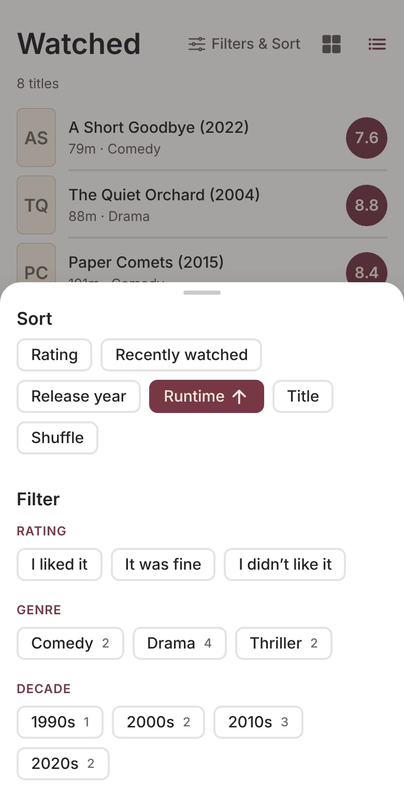
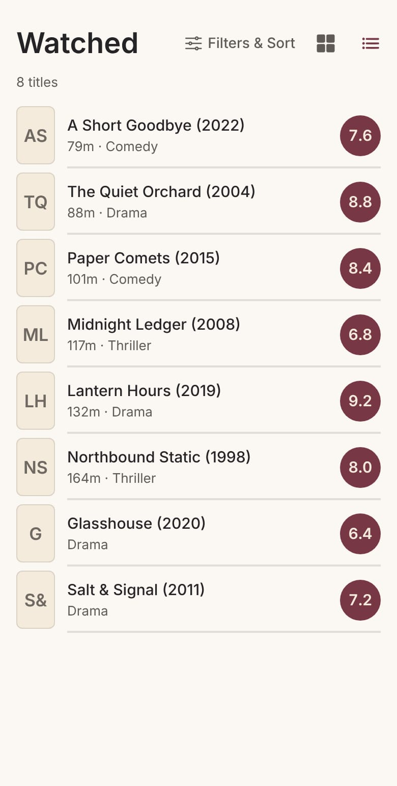
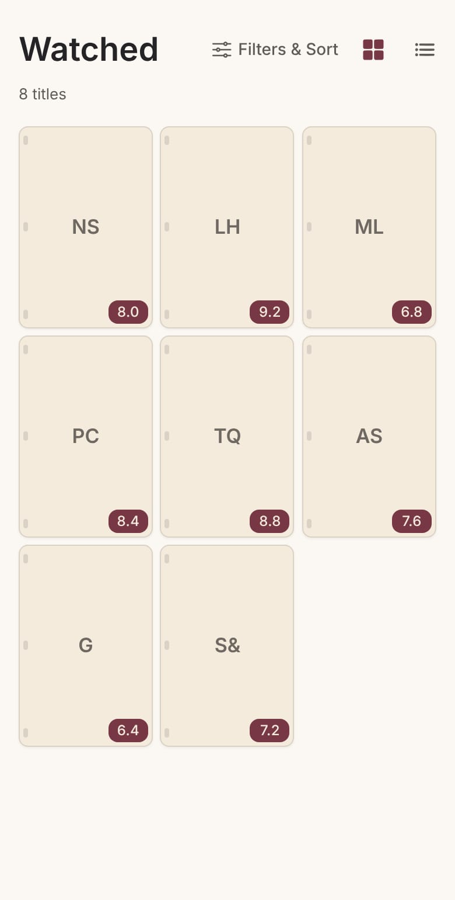
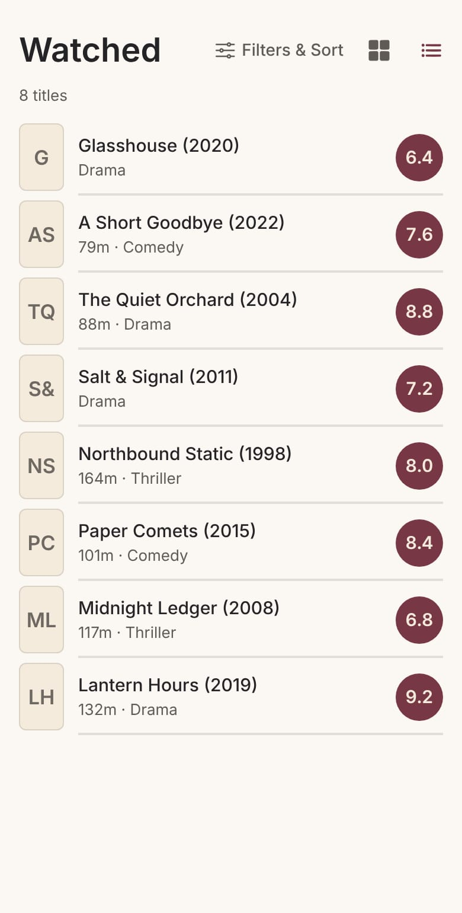
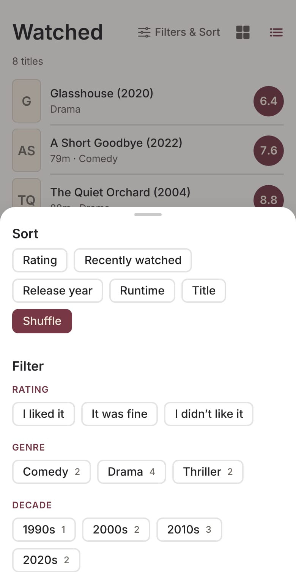
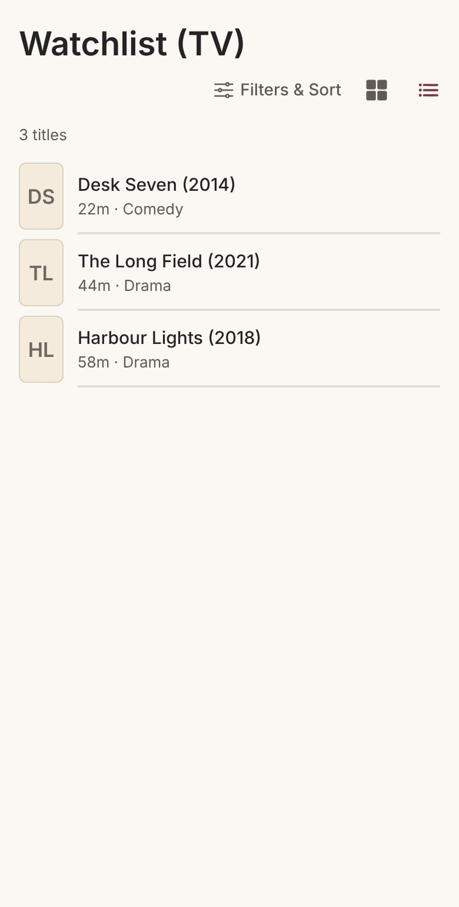

# Runtime sort and the Shuffle UX (2026-11-10)

Approved spec, 2026-11-10. The product rules are recorded beside the Collection sort table in
[`PRD.md`](../product/PRD.md) (the † note). This file covers release and QA.

## What changed

- **Runtime** is in Collection → Filters & Sort, beside Release year. The first press is
  **Shortest first ↑**, the second **Longest first ↓**, and later presses alternate. It uses the
  existing maroon selected style, with the arrow.
- Runtimes are compared as numbers. A null, missing, non-numeric, zero or negative runtime goes
  last in both directions. Equal runtimes break A–Z by title, then by id.
- **What a TV runtime means:**
  - A **series** stores the length of one typical episode (TMDB `episode_run_time[0]`). Series
    only appear on the Watchlist.
  - A **season** has no runtime by construction. It is not borrowed from the series and not
    totalled from episodes.
  - So Runtime is offered on Movies (Watched, Unranked, Watchlist) and on the TV Watchlist. It is
    not offered on TV Watched or TV Unranked, which hold seasons only.
  - No columns or migrations were added.
- **Shuffle:**
  - Every press deals a new order whose visible result differs from the order on screen. That
    includes pressing Shuffle from another axis and pressing it again while selected.
  - It applies at once and closes the sheet. It never waits for Apply, and it leaves unapplied
    filter drafts unapplied.
  - The toolbar reshuffle button (`collection-reshuffle`) is gone.
  - The selected Shuffle row stays enabled, with the hint "Tap again to reshuffle". A screen
    reader hears "Shuffled" when the sheet closes.
  - Each title's place is drawn from the seeded generator, using the seed and the title's own id.
    So scrolling, re-renders, refetches, filter changes and Grid/List switches never reorder it,
    and a title joining or leaving the list moves nobody else.

## Release implications

- **JavaScript only.** No package, `app.config.ts`, `eas.json`, asset or native change, so the
  runtime fingerprint does not move and this can be delivered by OTA. **It has not been published
  anywhere**, and nothing in this branch publishes, deploys or touches a database.
- **No data change.** No migration, RPC or query change. Sort state and the shuffle seed still
  live in Collection screen state, as before: they reset on relaunch, and only the view mode is
  persisted.

## Screenshots

These were rendered with Expo web from the real `CollectionView` and fixture data (fictional
titles, no posters). They are not device captures. Device QA below is still required.

| | |
| --- | --- |
|  |  |
|  |  |
|  |  |
|  | |

## Manual QA (Android and iOS, preview build or dev client)

Run every step on one Android device and one iPhone, in both Poster (grid) and List.

1. **Runtime: first press.** Open Collection → Movies → Watched → Filters & Sort. Runtime sits
   between Release year and Title. Tap it. It turns maroon with ↑, the sheet stays open, and the
   wall behind it reorders shortest first. Titles with no runtime (no `Nm` in the list row) are
   at the bottom.
2. **Runtime: later presses.** Tap Runtime again: ↓, longest first, and runtime-less titles are
   still at the bottom. Tap a third time: back to ↑. Close the sheet, then switch between Grid
   and List; the order holds.
3. **Filters still work.** With Runtime on, choose a genre and Apply. The count reads `N of M`
   and only that genre shows, still in runtime order. Clear all, then Apply, restores
   everything; Runtime stays selected.
4. **Other segments.** Movies → Watchlist and Movies → Unranked offer Runtime. TV → Watched does
   **not**: Runtime falls back to Rating there and returns to Runtime when you switch back to
   Movies. TV → Watchlist offers Runtime and orders series by episode length (`22m` before `58m`),
   with any saved seasons last.
5. **Shuffle from another axis.** Open Filters & Sort and tap Shuffle. The sheet closes at once,
   the wall is in a new order, and there is **no shuffle button** beside Filters & Sort.
6. **Shuffle again.** Reopen the sheet. Shuffle is selected (maroon) and enabled. Tap it: the
   sheet closes and the order changes. Repeat 5 times; the order changes every time. With a
   filter that leaves exactly 2 titles, each tap swaps them.
7. **Stability.** While shuffled: scroll to the bottom and back, switch Grid ↔ List, switch to
   Watchlist and back, open a title and come back, and background then foreground the app (which
   refetches). The order does not change. Rank one title out of
   Unranked while Unranked is shuffled: the others keep their relative order.
8. **Drafts.** Reopen the sheet, tick a genre (don't Apply), and tap Shuffle. The sheet closes,
   the shuffle applies, and the genre is **not** applied.
9. **Screen reader (VoiceOver / TalkBack).** On the Runtime row you hear "Runtime, shortest
   first", then "longest first" after a second tap. Focus the selected Shuffle row: you hear
   "Shuffle", selected, and the hint "Tap again to reshuffle". Activating it announces
   "Shuffled". Filters & Sort says "Sorted by Runtime, longest first" (or "Sorted by Shuffle").
10. **Regression sweep.** Rating, Recently watched, Recently added, Release year and Title each
    still apply on the press and reverse on a second press. Ranking a title, adding or removing
    from the Watchlist, and opening a title all behave as before.
